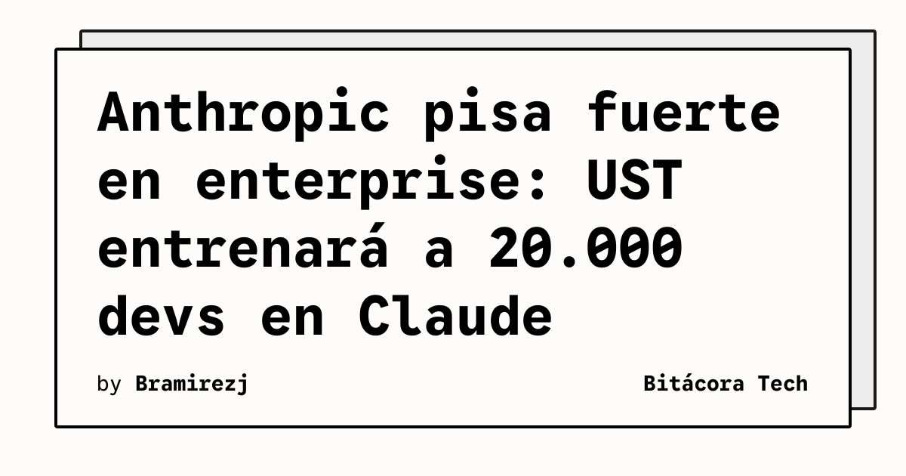

¡Buena cabros! Parece que Anthropic no quiere dejarle todo el pastel corporativo a OpenAI. Acaban de cerrar un partnership estratégico brutal con **UST**. 

La movida no es menor: estamos hablando de **capacitar a 20.000 desarrolladores** para que dominen Claude. Además, van a integrar los modelos de Anthropic directamente en los flujos de trabajo de ingeniería de sectores súper críticos como las telecomunicaciones y los semiconductores.

**¿Por qué importa esto?**
Básicamente, marca un punto de inflexión. Ya no es solo "qué modelo saca el mejor benchmark en Twitter", sino quién logra meterse en la maquinaria pesada de las empresas. Anthropic está apostando fuerte por ser la IA confiable y escalable para entornos enterprise pesados. Si estás armando algo en la nube, ojo con las herramientas que están saliendo para orquestar agentes con Claude, porque esta alianza va a empujar mucho ese ecosistema.
