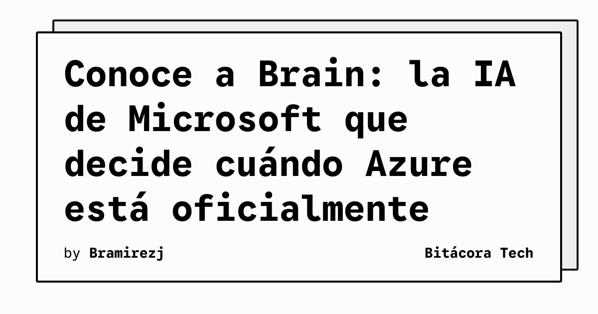

Microsoft abrió las puertas y mostró **Brain**, el sistema de IA interno que monitorea la salud de Azure en tiempo real. Y no solo observa: **declara outages, pausa rollouts peligrosos y notifica a clientes afectados** — todo con mínima intervención humana.

## ¿Qué hace Brain exactamente?

Es un sistema **AIOps** construido sobre Azure que:

- **Monitorea continuamente** la salud de todos los servicios de Azure globalmente
- **Detecta anomalías** antes de que escalen a incidentes mayores
- **Declara outages oficialmente** — sí, una IA decide cuándo Azure está "oficialmente down"
- **Pasa rollouts** que detecta como peligrosos antes de que causen daño
- **Notifica proactivamente** a los clientes impactados

## Por qué es interesante

Esto es AIOps llevado a escala absoluta. Azure tiene decenas de regiones, cientos de servicios, millones de clientes. La complejidad de detectar un outage real vs. un blip pasajero vs. un problema aislado es enorme. Que una IA tome esas decisiones en tiempo real dice mucho del estado del arte en observabilidad autónoma.

También es una señal de hacia dónde va la industria. **Elastic acaba de reportar que el 85% de las organizaciones ya usan GenAI para observabilidad**, con proyección al 98% en dos años. Los días del SRE mirando dashboards a las 3 AM están contados — los AI agents van a hacer el root cause analysis solos.

## La pregunta obvia

¿Confiamos en que una IA declare un outage sin validación humana? Microsoft claramente dice que sí, pero los casos edge siempre existen. El balance entre automatización y control humano va a ser uno de los debates más interesantes de 2026 en SRE.

**Fuentes:** The New Stack, Elastic 2026 Observability Report
