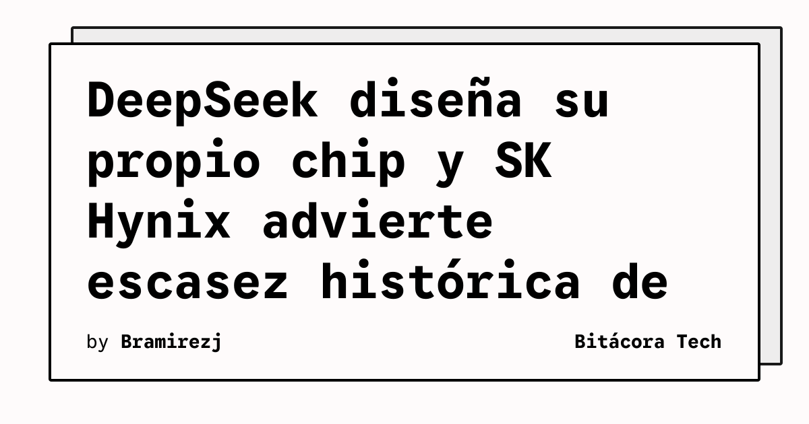

Mientras todos miran los benchmarks de modelos, la verdadera batalla de la IA se está librando un nivel más abajo: **el silicio**. Dos noticias de esta semana lo dejan clarísimo.

## DeepSeek se hace su propio chip

Reuters reportó que **DeepSeek está desarrollando su propio chip de IA**, enfocado específicamente en **inferencia** (no entrenamiento). Los detalles clave:

- Fabricación a cargo de **SMIC** (no TSMC), lo que es consistente con la estrategia de soberanía tecnológica china
- El objetivo es **reducir la dependencia de Nvidia y Huawei**
- Apunta al ~70% de la demanda de compute que será inferencia, no training

Esto no es un proyecto de laboratorio — es una respuesta directa a las restricciones de exportación de EE.UU. que han limitado el acceso de China a chips avanzados. Si el 70% del compute en producción es inferencia, tener tu propio chip para eso es una jugada estratégica enorme.

## SK Hynix: "la peor escasez de memoria de la historia"

El CEO de SK Hynix soltó una advertencia fuerte: el mercado de memoria podría enfrentar su **peor escasez de la historia en 2027**, con demanda superando oferta más allá de 2030. El culpable directo: la demanda impulsada por IA, especialmente la **memoria de alto ancho de banda (HBM)** usada en sistemas de IA avanzados.

Las expansiones de capacidad están en camino, pero no son suficientes para neutralizar el bottleneck de largo plazo.

## ¿Por qué te debe importar si haces DevOps/Infra?

1. **El costo de inferencia va a ser volatile.** Si la memoria escasea, los GPUs completos se vuelven más caros. Planificar presupuestos de IA con escalabilidad lineal es optimismo.
2. **Diversificación de proveedores de compute.** Si DeepSeek logra un chip de inferencia competitivo, el panorama de hardware para servir modelos se amplía. Los clouds chinos podrían ofrecer inferencia más barata.
3. **Optimización de modelos sigue siendo king.** Modelos más pequeños y eficientes (cuantización, pruning, distillation) son la mejor defensa contra la escasez de hardware. No puedes controlar el supply chain, pero sí cuánto compute necesitas.

La carrera de IA tiene dos pistas paralelas: quién hace el mejor modelo y quién controla el hardware para correrlo. Las dos importan.

---

**Fuentes:** [Reuters via Prompt Injection](https://www.promptinjection.net/p/ai-llm-news-roundup-july-02-july-12-2026), [The Data Journey](https://thedatajourney.substack.com/p/weekly-ai-digest-metas-pullback-and), [Memeburn](https://memeburn.com/china-nvidia-h200-limited-ai-firms/)
