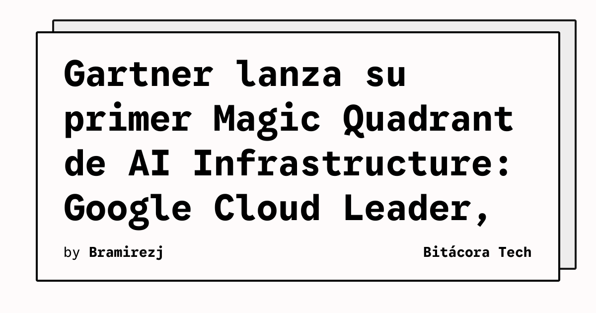

Gartner sacó su **primer Magic Quadrant para Cloud AI Infrastructure** y las posiciones son bastante clarificadoras del momento que vive la industria.

## Google Cloud: el Leader

Google fue nombrado **Leader**, posicionado **más alto en Ability to Execute** y **más lejos en Completeness of Vision**. El reconocimiento no es casualidad:

- **TPU 8t**: 9,600 chips por superpod, ~3x más compute por pod que la generación anterior, diseñado para training de frontier models
- **TPU 8i**: 288 GB HBM y 384 MB SRAM on-chip (3x más que antes), optimizado para inference agentic en tiempo real
- Sirve a **9 de cada 10 frontier AI labs**, además de empresas como Citadel Securities y Mercedes Benz
- Co-diseño de silicio + software desde hace más de una década

Google también confirmó que será uno de los primeros en ofrecer instancias **A5X basadas en Vera Rubin** de NVIDIA cuando estén disponibles este año.

## CoreWeave: Visionary

**CoreWeave** entró como **Visionary** en este primer MQ. Un reconocimiento importante para un player que nació como crypto miner y se transformó en uno de los mayores providers de GPU-as-a-service para AI. Su enfoque en performance pura y cost-efficiency para inference/training le está pegando fuerte a los grandes.

## ¿Qué nos dice esto?

El hecho de que Gartner cree un Magic Quadrant dedicado exclusivamente a **AI Infrastructure** confirma que este es un mercado distinto al cloud tradicional. No basta con tener datacenters — necesitas silicio optimizado, networking de alto rendimiento, y un software stack que saque el jugo a cada FLOP.

La competencia se va a poner brutal con Meta Compute entrando al ring (ver nuestro artículo de hoy), Google apretando con TPUs propios, y CoreWeave comiendo por abajo. AWS y Azure van a tener que responder fuerte.

**Fuentes:** Gartner, Google Cloud Blog, BusinessWire, IT Brief
