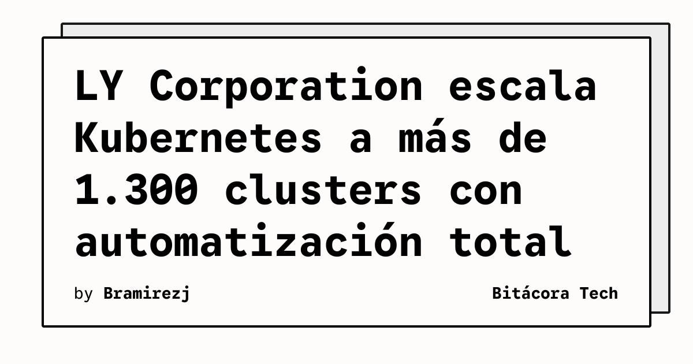

¡Buenas! Si alguna vez te ha dolido la cabeza administrando un par de clusters de Kubernetes, este *case study* que acaba de publicar la **CNCF** te va a volar la cabeza (y quizás a dar un poco de envidia).

**LY Corporation** ha logrado escalar su entorno de Kubernetes desde apenas 5 clusters hasta **más de 1.300 clusters** operando sobre infraestructura privada. ¿El secreto? **Automatización total**.

Administrar a esa escala de forma manual es derechamente imposible. Han tenido que construir plataformas internas (Platform Engineering al rescate) y automatizar todo el ciclo de vida: aprovisionamiento, actualizaciones, monitoreo y remediación de errores, para poder sostener esta bestialidad de despliegue sin que su equipo de SRE y DevOps muera en el intento.

**El take-away para nosotros:**
Esto refuerza la tendencia de que Kubernetes ya no se trata de "cómo instalo un cluster", sino de **cómo construyo una plataforma sobre K8s para gestionar cientos de ellos de forma desatendida**. GitOps, operadores personalizados y observabilidad avanzada no son "nice to have" a esta escala, son el estándar de supervivencia.