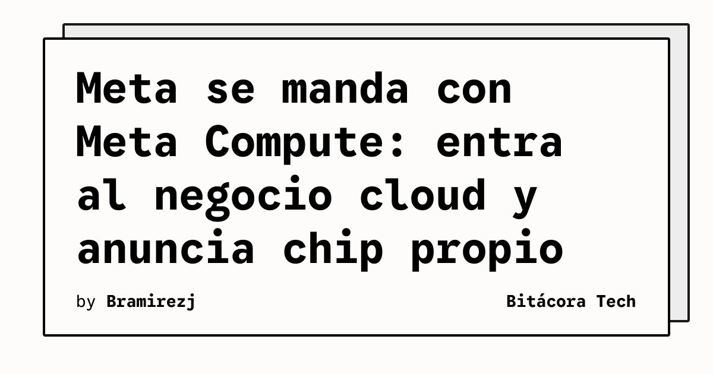

Meta dejó claro que ya no es solo una empresa de redes sociales y publicidad. Esta semana debutó **Meta Compute**, su nueva unidad de negocio cloud orientada a vender **infraestructura de IA y modelos foundation** a terceros. Sí, Meta ahora compite directamente con AWS, Azure y Google Cloud.

## Los números son brutales

- Meta tendrá **~7 GW de capacidad AI en 2026**, escalando a **14 GW en 2027**
- Según Wolfe Research, cada GW monetizado podría sumar **~20% al EPS**
- Las acciones subieron **15% en la semana** post-anuncio

## Iris: el chip propio

El otro bombazo: **Iris**, el chip AI diseñado por Meta en alianza con Broadcom y fabricado por TSMC, entra a producción en **septiembre 2026**. Puede correr workloads de training e inference, y reduce la dependencia de NVIDIA/AMD.

Menos dependencia de GPUs de terceros = menores costos de infraestructura a largo plazo. Simple.

## ¿Pero no todo es color de rosa?

Meta también tuvo baches esta semana:
- Retiró temporalmente **Muse Image** por preocupaciones de privacidad
- La UE metió multas adicionales
- Francia propuso obligar a publishers a aceptar pagos de Meta

Igual, el mercado lo ignoró todo y se enfocó en el potencial de Meta Compute. Las earnings del **29 de julio** van a ser clave: todos esperando guía de CapEx, timeline comercial de Meta Compute y detalles de Iris.

## ¿Por qué te importa?

Si estás evaluando providers de infra AI, Meta Compute es un nuevo jugador serio entrando al ring. Más competencia = mejores precios y más innovación para todos. Y si la estrategia del chip propio funciona, podría cambiar el panorama de costos de inference a nivel industria.

**Fuentes:** TradingKey, Wolfe Research, Meta IR

### Update: 14 de Julio de 2026 — Hyperion se vuelve gigantesco ($50B, 5GW)

Meta anunció hoy que su data center **Hyperion** en Richland Parish, Louisiana, se expande a **5 GW de capacidad** y una inversión total superior a **$50 mil millones**. Para ponerlo en perspectiva: antes de esta expansión, el proyecto era de 2 GW y $27 mil millones (en joint venture con Blue Owl Capital). Es decir, **casi duplicó el tamaño y el presupuesto**.

El campus llegará a **casi 10 millones de pies cuadrados** y será el data center más grande de Meta, dedicado principalmente a **AI training**.

### Los incentivos fiscales detrás

Louisiana metió una **exención de impuestos sobre ventas por 20 años** para data centers construidos antes de 2029, firmada por el gobernador republicano Jeff Landry a finales de 2024. Esto fue clave para que Meta eligiera el estado.

Meta aclara que "paga los costos completos de energía, agua e infraestructura" para que los consumidores no carguen con la cuenta. Igual, el debate sobre si estos incentivos fiscales son buen negocio para los estados sigue abierto.

Esto se suma al impulso de Meta Compute y el chip Iris: Meta está construyendo la infraestructura más grande de la industria para AI, y el Hyperion es la pieza física central de esa estrategia.

**Fuentes update:** CNBC, Reuters, The Hill, Louisiana Economic Development

### Update: 27 de Julio de 2026 — Acciones de CoreWeave caen por la amenaza de Meta Compute

El anuncio de Meta Compute empezó a cobrar víctimas en el mercado. Las acciones de CoreWeave (uno de los principales proveedores especializados en infraestructura de IA) se vieron golpeadas fuertemente tras confirmarse que Meta planea vender su capacidad de cómputo excedente a terceros.

Lo irónico de la situación: **Meta es actualmente uno de los clientes más grandes de CoreWeave**, atados por un acuerdo gigantesco de US$35 mil millones hasta el año 2032. El hecho de que tu mejor cliente de repente decida convertirse en tu competidor para revender capacidad es un balde de agua fría para los inversionistas. Esto confirma que el movimiento de Meta hacia el cloud no es solo un experimento, sino una jugada que altera el equilibrio de poder en la infraestructura AI.
