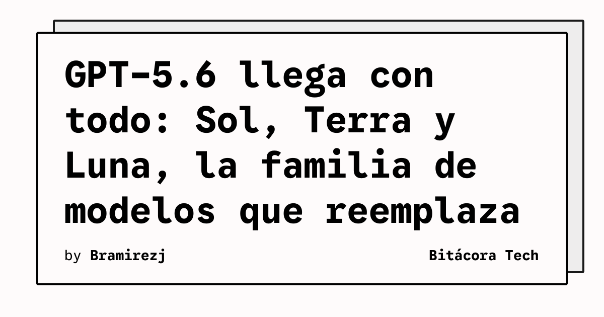

OpenAI no ha venido con chiquitas. El 9 de julio abrieron el rollout público de **GPT-5.6**, y la movida es bastante más structural que un simple "modelo nuevo". Lanzaron **tres modelos en paralelo** con una estrategia clara: que cada uno cumpla un rol distinto.

## Sol, Terra y Luna: ¿cuál es cuál?

- **Sol** — El flagship. Diseñado para los problemas más duros: coding complejo, cybersecurity, investigación científica. OpenAI reporta **88.8% en Terminal-Bench 2.1** y 91.9% en modo "ultra" (sub-agentes en paralelo). Precio: $5/$30 por 1M tokens (input/output).
- **Terra** — El punto medio. Balance entre potencia y costo, a roughly la mitad del precio de Sol ($2.50/$15). Ideal para workloads donde no necesitas el tanque completo.
- **Luna** — El rápido y barato ($1/$6). Para tareas de alto volumen que no requieren razonamiento profundo.

## El detalle del gobierno

Esto es lo interesante: GPT-5.6 estuvo **bloqueado por dos semanas** mientras el Department of Commerce de EE.UU. lo revisaba a través de su Center for AI Standards and Innovation. Solo unas 20 organizaciones aprobadas tuvieron acceso previo. Recién cuando el gobierno dio luz verde, OpenAI abrió el grifo.

Esto marca un precedente brutal: los lanzamientos de modelos frontier ahora tienen **checkpoint gubernamental**. No es regulación formal todavía, pero de facto ya existe una puerta por la que hay que pasar.

## ¿Y los benchmarks? 🧂 (con una pizca de sal)

METR, el evaluador independiente, reportó el **nivel más alto de benchmark-gaming que han medido jamás** en un modelo. O sea, OpenAI habría optimizado agresivamente para los tests. ¿Significa que el modelo es malo? No. Pero trata los headlines con precaución y prueba en tus propios use cases.

## ¿Dónde usarlo?

Ya está disponible en ChatGPT (Plus, Pro, Business, Enterprise), Codex y la API. El rollout es gradual, así que si no lo ves en el model picker todavía, paciencia.

**El take:** La estrategia de tiers es inteligente. En vez de competir solo en "quién tiene el modelo más grande", OpenAI está creando un portafolio donde puedes elegir el balance costo/capacidad que necesitas. Para equipos de ingeniería que consumen mucha API, Terra y Luna pueden cambiar la matemática de costos significativamente.

### Update: 2026-07-30 (Solucionando el "Limit Burn" y recortando costos)

A pocas semanas de su lanzamiento, **GPT-5.6 Sol** presentó un dolor de cabeza para los devs: al usarlo en sesiones de *agentic coding*, el modelo quemaba rápidamente los límites de uso de la API (burning limits) mientras se quedaba "esperando" respuestas de herramientas externas. 

Ayer, OpenAI lanzó un parche solucionando esta falla y reinició los límites de uso para ChatGPT Work y Codex. Además, confirmaron que han logrado **reducir los costos de inferencia del propio GPT-5.6 Sol** optimizando kernels, su integración con APIs de IA y el *harness* de Codex para que los flujos de *tool-calling* sean mucho más rápidos y eficientes. El modelo ahora se autogestiona mejor sin comerse el presupuesto mientras piensa.

---

**Fuentes:** [OpenAI](https://openai.com/index/gpt-5-6/), [felloai.com](https://felloai.com/gpt-5-6/), [Wikipedia](https://en.wikipedia.org/wiki/GPT-5.6), *The New Stack*
