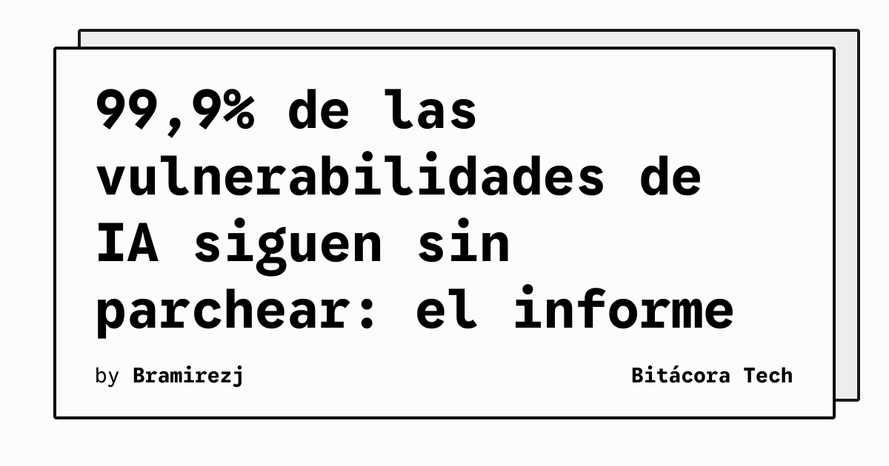

Orca Security publicó su **2026 State of AI Security Report** y los números son para ponerse serio. Analizaron telemetría anónima de más de **1.200 organizaciones en producción** durante Q2 2026, cubriendo AWS, Azure y Google Cloud.

## Los números que importan

- **99,9%** de las vulnerabilidades de IA que tienen fix disponible **siguen sin parchear**
- **81%** de las organizaciones corren paquetes de IA con vulnerabilidades conocidas
- El reporte cubre: AI cloud services, paquetes de IA, identidades y secrets, AI agents, vector databases, encriptación y gobernanza

## ¿Qué está pasando?

La velocidad de adopción de IA fue tan rápida que la **madurez de seguridad quedó muy atrás**. Los equipos están integrando modelos, APIs y agentes en producción sin procesos robustos de scanning de dependencias, gestión de secrets o hardening de configuración.

Es básicamente **shadow IT 2.0**, pero ahora con modelos que pueden ejecutar código, acceder a datos sensibles y tomar decisiones autónomas.

## ¿Qué hacer al respecto?

Si tienes IA corriendo en tu infraestructura (y probablemente la tienes, aunque no lo sepas oficialmente):

1. **Inventario:** ¿Qué modelos, paquetes y APIs de IA están corriendo en tu environment? No puedes asegurar lo que no sabes que existe.
2. **Scanning de dependencias:** Integrar scanning de paquetes de IA en el CI/CD. Lo mismo que haces con npm/pip, pero para librerías de ML.
3. **Gestión de secrets y identidades:** Los AI agents necesitan credenciales para funcionar. ¿Están rotadas? ¿Tienen least privilege?
4. **Observabilidad de IA:** Monitorear no solo latency y throughput, sino qué datos están accediendo los modelos y qué acciones están tomando los agentes.

El reporte completo vale la pena leerlo, especialmente si estás en Cloud Security o platform engineering. La brecha entre adopción de IA y madurez de seguridad no se va a cerrar sola.

---

**Fuente:** [Orca Security via Business Standard](https://www.business-standard.com/content/press-releases-ani/orca-security-report-99-9-of-fixable-ai-vulnerabilities-remain-unpatched-as-ai-moves-126071300359_1.html)
