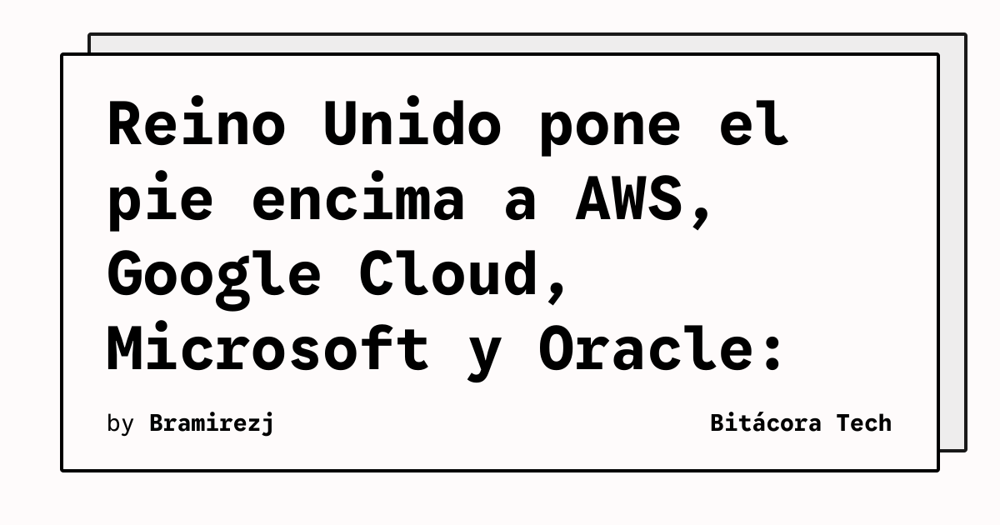

El Reino Unido no anda con vueltas. Hoy **13 de julio de 2026** entra oficialmente en vigor el régimen de **Critical Third Parties (CTP)**, una normativa que pone a AWS, Google Cloud, Microsoft y Oracle bajo supervisión directa del Banco de Inglaterra, la PRA y la FCA.

## ¿De qué se trata?

La idea es simple: si el 65% de las instituciones financieras del país dependen de un puñado de providers cloud, un solo incidente puede tumbar el sistema financiero completo. Ya lo vimos con los cortes masivos de CrowdStrike y Azure — bancos, aerolíneas y pagos paralizados en segundos.

Ahora estos providers son legalmente responsables de:

- **Identificar y mitigar riesgos operacionales** en los servicios críticos que entregan al sector financiero
- **Comunicar en tiempo real** con reguladores y clientes durante incidentes
- **Cumplir reglas de conducta**: transparencia, integridad, reporte de incidentes y estrategias de término orderly

## Ojo que no son entidades reguladas

Esto **no convierte** a Big Tech en entidades financieras reguladas. Es un oversight enfocado puramente en **resiliencia operacional**. Las empresas reguladas siguen siendo 100% responsables de su propia gestión de riesgos de terceros. El régimen complementa, no reemplaza.

## Contexto internacional

El movimiento espejea lo que está haciendo la UE con **DORA** (Digital Operational Resilience Act), aunque el scope británico es más acotado: solo cuatro designados por ahora.

## ¿Por qué importa?

Si trabajas en DevOps, SRE o arquitectura en el sector financiero (o cualquier empresa que opere en UK), esto cambia el juego. Los SLAs, los contratos de cloud, los procesos de incident response — todo va a necesitar revisión. Y los providers van a tener que ser mucho más transparentes con lo que pasa detrás de cortina.

La concentración cloud era un riesgo que todos conocían pero nadie quería enfrentar. Hoy empieza la cuenta regresiva.

**Fuentes:** Bank of England, FCA, HM Treasury, bobsguide
