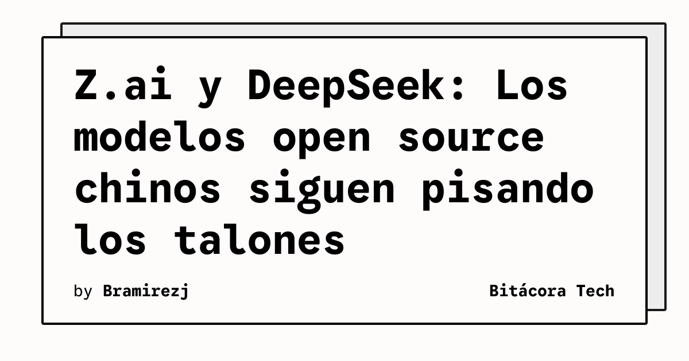

Si pensabas que la carrera de la IA iba a ser solo entre un par de laboratorios en San Francisco, piénsalo de nuevo. Las últimas horas han dejado claro que el ecosistema chino no está jugando a las escondidas.

Por un lado, tenemos a **DeepSeek**, que sigue consolidándose como el líder indiscutido en la arena open-source asiática, demostrando capacidades brutales y con arquitecturas súper eficientes. Pero la gran novedad es la startup **Z.ai**, que acaba de plantarse con **GLM-5.2**. Los reportes indican que este modelo se para de igual a igual frente a los titanes americanos en rendimiento general.

El mismísimo Jie Tang (fundador de Z.ai) ya tiró el dardo: predicen que China va a liberar un modelo "clase Fable" (nivel next-gen) antes de que termine el 2026. 

**Resumen rápido:** La diversificación de los modelos está a tope. Para los que arman arquitectura de software, depender de una sola API empieza a ser un anti-patrón. Hay que abstraer, porque las opciones open-source top tier van a seguir cayendo como lluvia.

### Update: 2026-07-13 (Nuevas métricas de mercado)
Los números están respaldando el hype. Datos recientes muestran que el uso de tokens de la familia Claude (Anthropic) cayó del 29% al 13.3% en el último tiempo, mientras que alternativas chinas como **DeepSeek**, **GLM-5.2**, **Qwen** y **Kimi** están capturando esa cuota de mercado a una velocidad brutal. 

¿La razón principal? **El costo y el rendimiento**. Estos modelos open-source y open-weight están resultando entre un **60% y 90% más baratos** que los tiers premium de OpenAI o Anthropic. Para rematar, los benchmarks más recientes indican que **GLM-5.2 ya supera a GPT-5.5 en SWE-Bench Pro**, lo que está haciendo que varias startups comiencen a migrar su tráfico 100% hacia proveedores como DeepSeek. La guerra de precios y performance en la API está desatada.

### Update: 14 de Julio de 2026

DeepSeek no solo está ganando terreno en uso y desarrollando hardware, sino que está levantando capital a niveles astronómicos para sostener este crecimiento. Reportes recientes indican que la empresa está en **charlas preliminares para levantar una nueva ronda de inversión a una valuación cercana a los $71 billones de dólares**. 

Esto es una locura considerando que a finales de mayo (hace menos de dos meses) levantaron $7 billones a una valuación de $52 billones. Esta inyección bestial de capital tiene un objetivo clarísimo: **construir la infraestructura masiva necesaria (GPU clusters, energía, data centers)** para seguir dándole pelea a OpenAI y Anthropic. La guerra de la IA no es solo de código, es de billetera.

### Update: 14 de Julio de 2026 — Los modelos open-source chinos ya dominan en volumen

Un artículo de TechCrunch de hoy confirma con datos lo que veníamos viendo: **los modelos open-weight chinos ya superaron a los estadounidenses en volumen de uso en plataformas clave**.

Los números son contundentes:
- **41% de las descargas en Hugging Face** este spring fueron de modelos chinos, superando a los de EE.UU.
- En **OpenRouter**, los 6 modelos más populares son **todos open-weight de firms chinas**: Tencent, Xiaomi, DeepSeek, MiniMax y Z.ai. Claude Opus 4.7 de Anthropic está en el 7º lugar.
- En **Vercel**, los modelos open manejaron **casi un tercio** de las peticiones de AI en junio.

El CEO de Hugging Face, Clem Delangue, lo resume así: los modelos frontier van a quedar para "experimentación y tareas de alto valor", mientras que la mayoría de los workloads de producción van a correr en modelos open-source más baratos y personalizables.

La pregunta incómoda: ¿cuánto importan los modelos frontier cerrados si la mayoría de la IA en producción termina corriendo en alternativas más baratas?

**Fuentes update:** TechCrunch, Hugging Face State of OS Spring 2026, OpenRouter Rankings, Vercel AI Gateway

### Update: 25 de julio — GLM-5.2 confirmado como #1 open-weight en Artificial Analysis

Los benchmarks ahora le dan la razón al hype. **Artificial Analysis confirmó que GLM-5.2 es el modelo open-weight #1 en su Intelligence Index v4.1**, con un score de **51**, por encima de MiniMax-M3 y DeepSeek V4 Pro.

Otros datos clave que se confirmaron:

- **SWE-bench Pro: 62.1** — supera a GPT-5.5 (58.6), aunque debajo de Claude Opus 4.8 (69.2)
- **Design Arena:** #1 en evaluación single-turn de HTML web design, beatando a Claude Fable 5
- **Arquitectura:** 744B parámetros MoE, ~40B activados por token
- **Contexto:** 1M de tokens (vs 200K en GLM-5.1)
- **Pricing API:** $1.40/M input, $4.40/M output
- **Licencia:** MIT en Hugging Face

El detalle geopolítico que está dando vuelta: Foreign Affairs Forum reportó que GLM-5.2 fue **entrenado en procesadores Huawei Ascend 910B**. O sea, el modelo open-weight más capaz del momento se entrenó en chips chinos, lo que corta de raíz el supuesto de que los controles de exportación de EE.UU. iban a frenar el avance de la IA china.

Y para los que quieren correrlo local: un Mac Studio 256GB puede cargar el GGUF 2-bit (~239GB en disco) y obtener **3-9 tokens/segundo** vía llama.cpp. No es rápido, pero es un asistente de código privado que no envía datos a ninguna parte.

*Fuentes update: Artificial Analysis, Startup Fortune, Morphllm, FelloAI*
