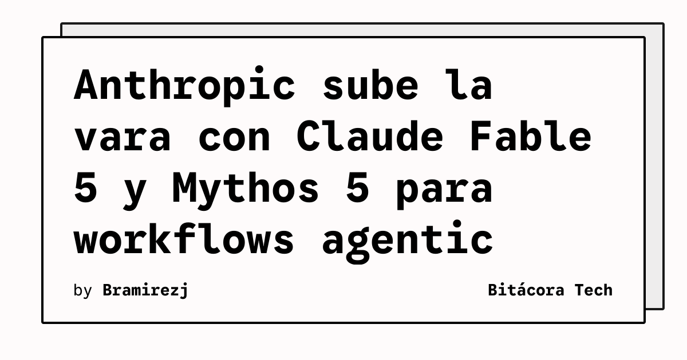

Anthropic no baja el ritmo y acaba de sacudir el ecosistema anunciando su nueva línea de modelos: **Claude Fable 5** y **Claude Mythos 5**. 

Si Opus ya nos había volado la cabeza hace un tiempo, Anthropic ahora se está posicionando directamente para dominar el trabajo "agentic" de largo aliento.

## Lo que sabemos de los nuevos modelos

- **Fable 5:** Lo definen como el modelo "más capaz lanzado ampliamente por Anthropic", diseñado específicamente para razonamiento exigente, tareas autónomas (agentes) y programación dura.
- **Specs de locos:** Estamos hablando de una **ventana de contexto de 1.000.000 tokens** y un límite de output de 128.000 tokens. Básicamente, puedes pasarle repositorios de código completos o bibliotecas enteras para que trabaje autónomamente sobre ellos.
- **Precio (vía OpenRouter):** Fable 5 se asienta en los \$10 por millón de tokens de input y \$50 por millón de output. Un precio premium, pero esperado para la categoría "Mythos-class" que busca destronar al tope de línea de OpenAI y Google.

Adicionalmente, se supo que Anthropic extendió el acceso incluido a Fable 5 para sus usuarios de planes de pago hasta mediados de julio, para que puedan probar la potencia de este nuevo monstruo de razonamiento.

## El impacto en DevOps y Cloud

Para los que estamos armando infra, esto significa que el ecosistema de **agentes autónomos** (como los que hacen CI/CD automáticos, revisan PRs complejos o auditan arquitecturas enteras leyendo documentación en la nube) está a punto de recibir una inyección de inteligencia brutal. Las limitaciones de contexto quedaron en el pasado; el desafío ahora es cómo orquestamos y costeamos estas operaciones masivas.

### Update: 15 de Julio de 2026 — Filtran "Honeycomb" (Claude Opus 5) y Fable 5 lidera benchmarks

Anthropic extendió por **tercera vez en cinco semanas** el acceso gratuito a Claude Fable 5, ahora hasta el **19 de julio**. La razón oficial no la dieron, pero la extraoficial es jugosa: desarrolladores que encontraron el modelo dentro de Cursor descubrieron algo que no debían ver.

## El leak de "Honeycomb" (Claude Opus 5)

Un listado filtrado reveló lo que parece ser **Claude Opus 5**, nombre en clave **"Honeycomb"**. Lo que encontraron los developers antes de que Anthropic lo cerrara:

- **Ventana de contexto de 1 millón de tokens** (igualando a Fable 5)
- **Modo de razonamiento "extra high"**: un nivel por encima del máximo actual
- **Fallback de seguridad que rutea prompts sensibles a Claude Opus 4.8** en lugar de manejarlos directamente

Este último punto es clave: si Honeycomb necesita un fallback a Opus 4.8 para ciertos dominios (ciberseguridad, biología), significa que Opus 5 se posiciona **por encima** de Fable 5 en la jerarquía de modelos de Anthropic. Fable 5 ya tiene un mecanismo similar documentado.

## Fable 5 lidera el Artificial Analysis Intelligence Index

Según la actualización de julio 2026 de Artificial Analysis (vía BenchLM):

1. **Claude Fable 5:** 59.9%
2. **GPT-5.6 Sol:** 58.9%
3. **Claude Opus 4.8:** 55.7%

Fable 5 está en la cima del benchmark, pero si Honeycomb/Opus 5 supera a Fable 5 (como sugiere la jerarquía de fallbacks), Anthropic tendría los dos mejores modelos del mercado simultáneamente.

## Qué esperar

Con el acceso gratuito extendido otra vez, todo apunta a que Anthropic está cazando bugs y afinando detalles antes de un lanzamiento mayor. La pregunta es si Opus 5 "Honeycomb" se anuncia formalmente pronto o si seguirá siendo el modelo que "no existe" pero que todos vieron dentro de Cursor.

**Fuentes update:** The New Stack, Geeky Gadgets, BenchLM, Artificial Analysis