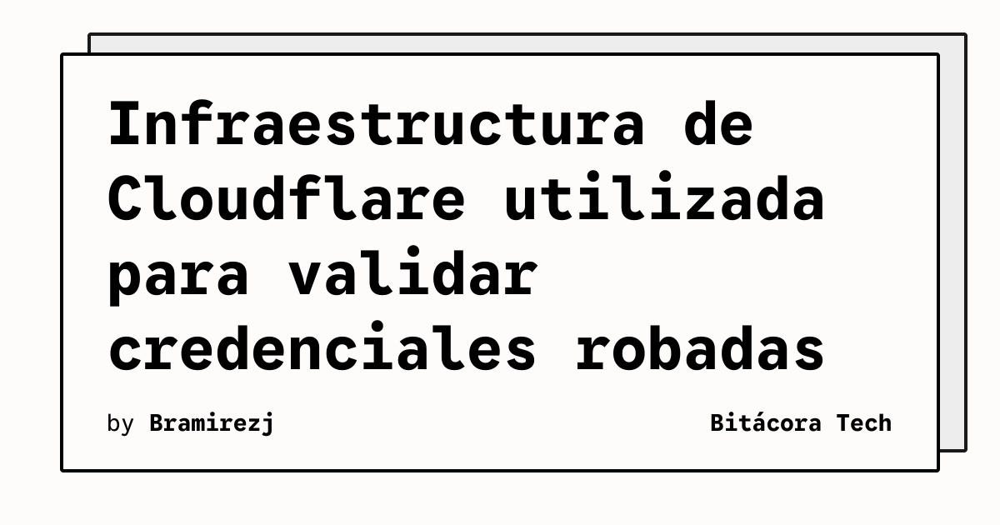

La seguridad cloud sigue siendo un dolor de cabeza constante. Hoy nos enteramos de una nueva campaña maliciosa bastante sofisticada que está afectando directamente a los usuarios de **Microsoft Entra** (lo que antes conocíamos como Azure AD).

Según los reportes más recientes, atacantes han estado utilizando la infraestructura de **Cloudflare** para realizar *spoofing* (suplantación) de Client IDs de OAuth. ¿El objetivo? Validar si las credenciales robadas de Microsoft Entra siguen activas y funcionales.

## ¿Cómo funciona el ataque?

Básicamente, los atacantes levantaron un sistema bautizado como `UNK_OutFlareAZ`, el cual utiliza la red de Cloudflare para enmascarar su origen. Desde ahí, lanzan peticiones masivas utilizando IDs de aplicaciones generados aleatoriamente (más de 3.7 millones de IDs falsos) para interactuar con los endpoints de autenticación de Microsoft.

Al usar Cloudflare, logran eludir muchos de los bloqueos geográficos o listas negras de IPs tradicionales, apuntando a más de **2 millones de usuarios**.

## El impacto en Cloud y DevOps

Esto nos deja un par de lecciones pesadas para quienes administramos infraestructura:
1. **El perímetro tradicional murió:** Bloquear IPs ya no sirve de mucho cuando los atacantes usan CDNs globales legítimos como Cloudflare para enmascarar su tráfico.
2. **Monitoreo de OAuth:** Los equipos de SecOps y Cloud necesitan enfocarse en el comportamiento de autenticación (AuthN/AuthZ), rastreando anomalías en los flujos de OAuth y no solo los intentos de login fallidos clásicos.

Si estás usando Entra ID en tu empresa, es buen momento para revisar los logs de autenticación anómalos y reforzar políticas de Conditional Access y MFA. No dejes que te validen las credenciales por la puerta trasera.
