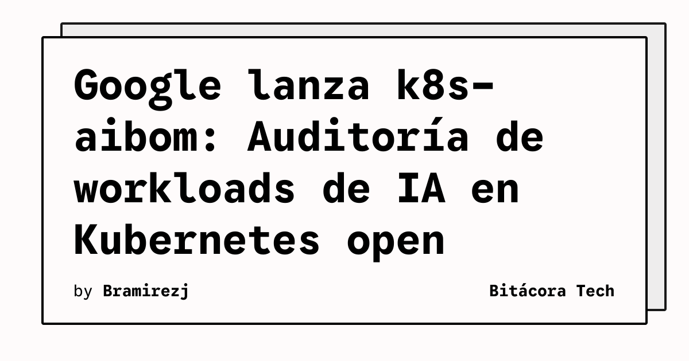

La gobernanza de la IA acaba de recibir un salvavidas gigante de parte de Google. Hoy anunciaron la liberación open-source de **k8s-aibom**, una herramienta diseñada específicamente para clústeres de Kubernetes que te ayuda a identificar *workloads* de Inteligencia Artificial que andan sueltos sin registro.

## ¿Qué hace exactamente k8s-aibom?

En palabras simples, es un generador de "Machine Learning Bill of Materials" (ML-BOM) pero para entornos vivos. Genera una boleta de materiales de tus cargas de trabajo de IA para mantener un registro inmutable. 

- **Auditoría histórica inmutable:** En la implementación para Cloud Storage, la creación de objetos usa una precondición `DoesNotExist`. Esto significa que un ML-BOM almacenado no se puede sobrescribir una vez creado. Esto es clave para investigaciones de seguridad o auditorías de cumplimiento.
- **Preparando el terreno para regulaciones:** Google diseñó esto pensando en que las empresas tengan un output estandarizado de sus entornos de Kubernetes para juntar evidencia frente a regulaciones duras como el **EU AI Act**, el NIST AI Risk Management Framework, y la norma ISO/IEC 42001.

## ¿Por qué esto es importante para Infra / DevOps?

Si eres el que mantiene el clúster, sabes que a veces los devs de data tiran contenedores a correr sin mucha visibilidad. Con **k8s-aibom**, la época de "no sabía que teníamos un modelo consumiendo todos esos recursos GPU en ese namespace" se acaba. 

Esto le da a los equipos de plataforma y seguridad una forma directa de mapear controles técnicos y tener trazabilidad total sobre lo que está pasando en Kubernetes en tiempos de boom de IA. Un movimiento súper sólido de Google para seguir empujando a Kubernetes como el orquestador rey, no solo de microservicios, sino del stack de MLOps.