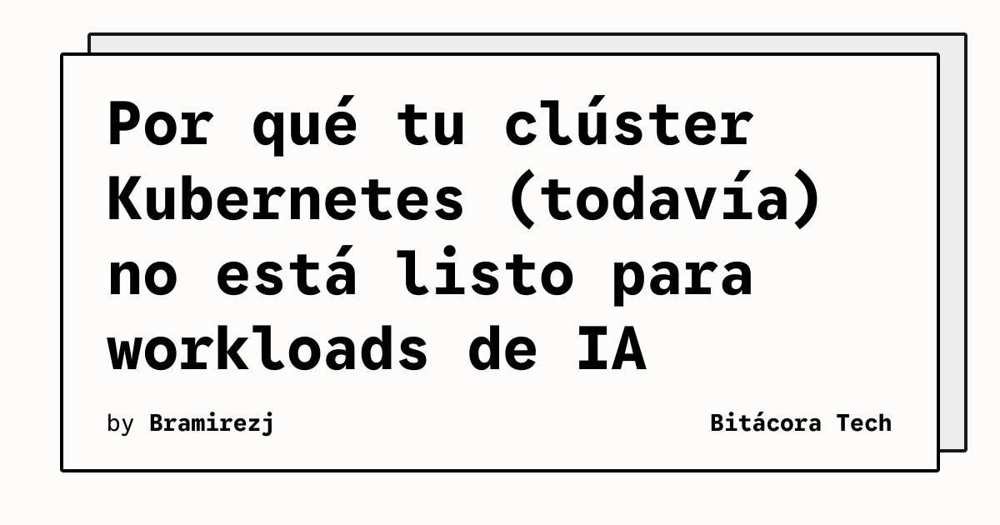

Kubernetes se ha comido el mundo del backend y la infraestructura, pero cuando se trata de Inteligencia Artificial y Machine Learning pesado, la relación es un poco más complicada de lo que parece. Análisis recientes en la comunidad apuntan a un culpable principal que rompe la armonía: **el drift (la desviación)**.

## El problema del estado deseado

Kubernetes es excelente manteniendo un "estado deseado" (desired state). Le dices: "quiero 5 réplicas de este contenedor web", y el *control plane* se encarga de que así sea, reiniciando pods si fallan. 

El problema es que **los workloads de IA no son microservicios estáticos**. 
- **Data drift:** Los datos de entrada en producción cambian con respecto a los datos con los que se entrenó el modelo.
- **Concept drift:** La relación entre las variables de entrada y lo que se intenta predecir muta con el tiempo.

Para Kubernetes, mientras el contenedor esté arriba respondiendo HTTP 200, todo está perfecto (el Liveness Probe pasa). Pero a nivel de negocio y MLOps, el modelo podría estar alucinando o entregando predicciones basura por culpa del drift, y k8s no tiene ni idea.

## Ajustando el stack para IA

Para que Kubernetes realmente esté listo para el boom del GenAI y ML, los equipos de DevOps y Plataforma están teniendo que extender las capacidades del clúster usando:
1. **Operadores especializados (como Kubeflow):** Que entienden el ciclo de vida de un modelo de ML, no solo de un contenedor genérico.
2. **Métricas de Observabilidad Custom:** No basta con medir CPU y memoria. Las herramientas de observabilidad (Prometheus, Grafana) ahora tienen que ingestar métricas de rendimiento del modelo y latencia de inferencia por token.
3. **Escalado predictivo:** KEDA y otros autoescaladores están evolucionando para adelantarse a picos masivos de inferencia que los HPA (Horizontal Pod Autoscalers) tradicionales no logran atajar a tiempo.

Kubernetes será la base de la revolución de la IA, pero el ecosistema todavía está parcheando las grietas entre gestionar infraestructura y gestionar modelos matemáticos vivos.