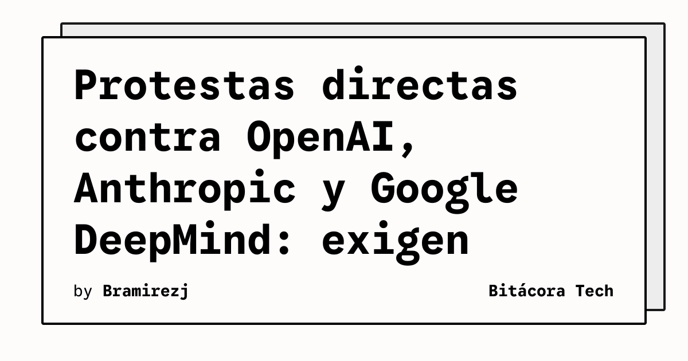

La presión social sobre la Inteligencia Artificial está escalando de los foros de internet y las cartas abiertas a las calles. 

En las últimas horas, grupos de manifestantes han apuntado directamente a las oficinas y a los ejecutivos de **OpenAI, Anthropic y Google DeepMind**, exigiendo una pausa total en el entrenamiento de nuevos sistemas de IA más capaces.

## Del "hype" al miedo real

Ya habíamos visto intentos regulatorios y cartas de académicos, pero las protestas actuales tienen un tono mucho más directo y activista. La consigna es clara: **quieren detener el avance de los modelos de frontera** (los equivalentes a los próximos GPT-6 o Claude 6) hasta que existan garantías absolutas de seguridad y alineación.

Esto choca de frente con la realidad del mercado:
- OpenAI acaba de liberar GPT-5.6 tras el escrutinio del gobierno de EE.UU.
- Anthropic sigue lanzando iteraciones de su familia Claude (Fable, Mythos).
- El hardware para estos modelos se está vendiendo a niveles nunca antes vistos.

## ¿Por qué importa para la industria?

Para los que estamos en infraestructura, arquitectura o dev, el debate no es menor. Las presiones regulatorias y sociales pueden traducirse en **pausas forzadas, más auditorías gubernamentales (como ya vimos con el Center for AI Standards and Innovation) y posibles cambios drásticos en cómo se disponibilizan las APIs**.

Si la industria se ve obligada a frenar el desarrollo de modelos fundacionales, probablemente veamos una explosión aún mayor en la adopción y optimización de **modelos locales y open source**, donde el control vuelve a las manos de los equipos de ingeniería y no depende de los caprichos o bloqueos regulatorios de un puñado de laboratorios en Silicon Valley.
