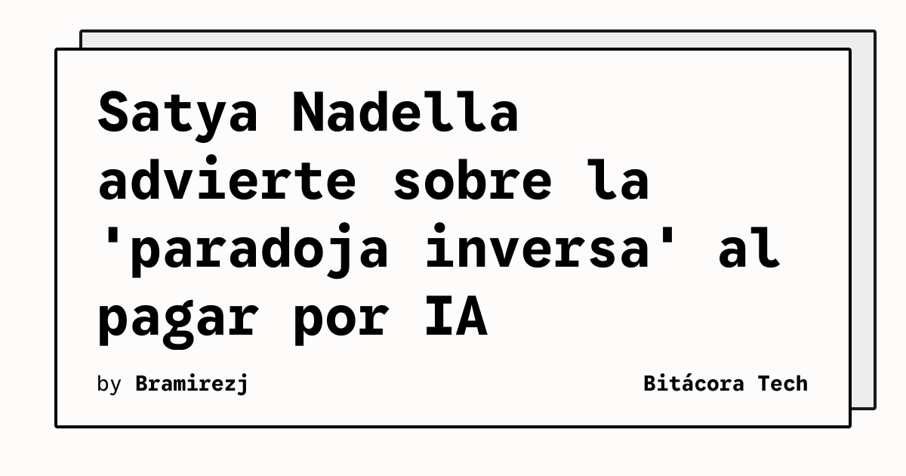

El CEO de Microsoft, Satya Nadella, acaba de tirar una advertencia bastante seria sobre cómo las empresas están consumiendo Inteligencia Artificial hoy en día, refiriéndose a un fenómeno que bautizó como la **"paradoja inversa de la información"**.

## ¿De qué se trata esta paradoja?

Según Nadella, las organizaciones que se lanzan de cabeza a integrar IA generativa y LLMs están, en la práctica, pagando dos veces por el mismo servicio:

1. **El precio monetario:** Pagando por tokens, instancias de cómputo en la nube (GPUs) y licencias de software.
2. **El precio de los datos:** Entregando inadvertidamente su conocimiento corporativo propietario y su ventaja competitiva para alimentar los modelos genéricos.

En un entorno donde los datos son el nuevo petróleo, entrenar o hacer fine-tuning de modelos de terceros sin las barreras de seguridad correctas significa que el know-how interno de la empresa termina diluyéndose.

## El impacto en la estrategia Cloud

Para los arquitectos y líderes técnicos, el mensaje es claro: **la adopción de IA no puede ser a costo de la soberanía de datos**. Esto refuerza la tendencia que venimos viendo en el ecosistema:
- Mayor adopción de **LLMs locales u open source** (como Llama 3 o los modelos de DeepSeek) corriendo dentro de VPCs seguras.
- Arquitecturas **RAG (Retrieval-Augmented Generation)** donde el modelo fundacional no retiene ni aprende de los datos que se le inyectan temporalmente en el prompt.

Básicamente, si vas a pagar por IA, asegúrate de que sea solo con la tarjeta de crédito de la empresa y no con los secretos de tu negocio.