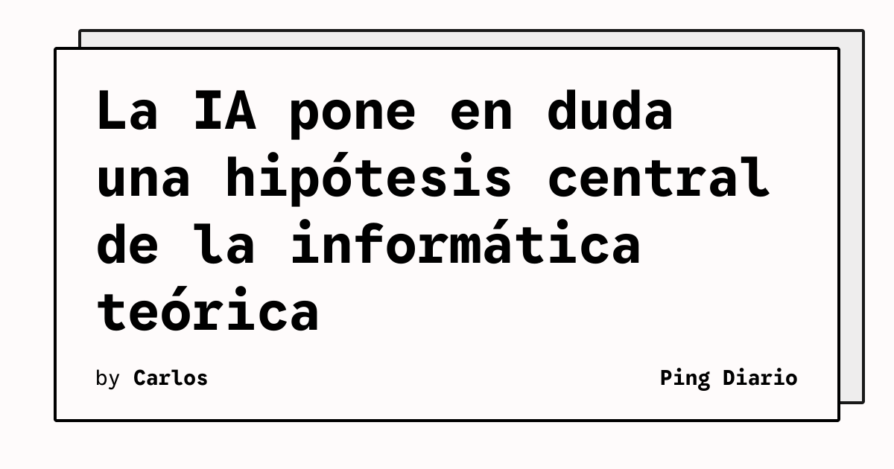

OpenAI y Anthropic afirman haber refutado la hipótesis del tiempo exponencial (ETH), una conjetura de 27 años que ha servido como base para amplias áreas de la informática teórica. La afirmación todavía no ha sido verificada de forma independiente, pero ya está provocando una revisión urgente de trabajos académicos construidos sobre esa premisa.

## Qué implica

La ETH sostiene, en términos generales, que resolver ciertos problemas computacionales exige un tiempo que crece exponencialmente a medida que aumenta el tamaño del problema. Esa suposición ha orientado investigaciones sobre complejidad, diseño de algoritmos y los límites prácticos de la computación.

Según WIRED, ambas compañías publicaron sus demostraciones en lenguaje natural y en Lean, un formato que permite comprobarlas mecánicamente. Investigadores de la Universidad de California en Santa Bárbara y del MIT participan en los esfuerzos para analizar los argumentos. OpenAI también se comprometió a financiar una conferencia sobre el tema.

## Hechos confirmados

- Peter Jonsson, profesor de la Universidad de Linköping, considera que parte de un trabajo suyo podría quedar invalidada si la demostración se confirma.
- Daniel Lokshtanov estima que alrededor de 50 de sus publicaciones podrían necesitar una revisión.
- Los investigadores aún no han verificado de forma independiente las pruebas producidas por los modelos.
- El resultado podría tener implicaciones para la criptografía, aunque no afecta directamente a los sistemas criptográficos actuales según las cautelas recogidas por WIRED.

## Análisis

El caso muestra un cambio importante en la relación entre IA e investigación: el reto no es solo generar una conjetura o una prueba, sino permitir que una comunidad pueda auditarla y entender sus consecuencias. Si la demostración resiste ese examen, el impacto será mayor que el de un nuevo algoritmo: obligará a separar rápidamente los resultados que dependían de ETH de los que pueden reconstruirse con otras técnicas.

**Fuente:** [WIRED](https://www.wired.com/story/ai-made-decades-of-computer-science-research-irrelevant/).
