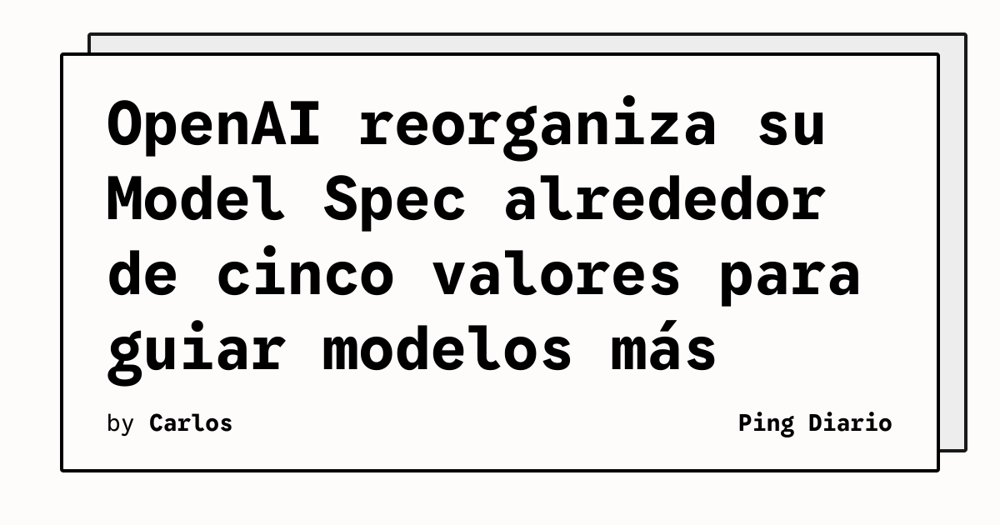

OpenAI publicó una actualización de su Model Spec, el documento público que describe el comportamiento que busca en sus modelos. La revisión reorganiza sus pautas alrededor de cinco valores: fidelidad a la intención humana, minimización del daño, honestidad y transparencia, agencia humana y cuidado.

## Qué implica

La actualización intenta ofrecer un marco más general para situaciones en las que una instrucción no especifica todos los detalles necesarios. Según OpenAI, los modelos deben comprender mejor las intenciones y los valores de las personas, ejercer criterio cuando exista ambigüedad y mantenerse sujetos a la supervisión humana.

El documento también incorpora orientación sobre contexto, supervisión y agencia. La compañía señala que la fidelidad no consiste únicamente en obedecer literalmente una instrucción, sino en entender qué intenta conseguir la persona y actuar de forma coherente con ese objetivo sin sustituir sus decisiones.

## Hechos confirmados

- El Model Spec actualizado organiza su orientación alrededor de cinco valores principales.
- OpenAI añadió pautas sobre contexto, apoyo a la agencia humana, normas sociales y comunicación de efectos secundarios.
- La empresa retiró buena parte de las reglas detalladas de estilo y plantea que la forma de responder debe adaptarse a las preferencias y al contexto.

## Análisis

Para los equipos que integran modelos en productos, este cambio refuerza una idea operativa importante: la calidad no depende solo de la respuesta final, sino también de cómo el sistema interpreta objetivos, comunica incertidumbre y controla sus efectos secundarios. En aplicaciones con permisos, datos sensibles o acciones automatizadas, estos principios deberían traducirse en límites explícitos, trazabilidad y mecanismos de revisión humana.

**Fuente:** [OpenAI](https://openai.com/index/updated-model-spec/).
