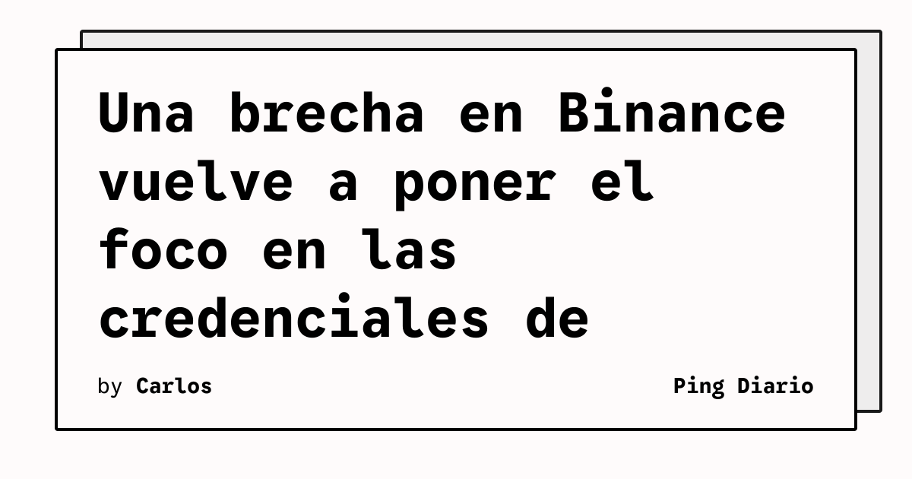

TechCrunch informa que hackers vinculados a Corea del Norte son sospechosos de haber comprometido el portátil de un empleado de Binance. Según el artículo y el resumen de la fuente, ese acceso habría permitido el robo de miles de millones en criptomonedas, en una operación que el medio presenta como una brecha récord de 6.300 millones de dólares.

## Qué implica

La noticia sitúa el equipo de un empleado como un punto decisivo dentro de una cadena de ataque contra una plataforma de activos digitales. El resumen disponible no describe el método técnico empleado ni especifica qué controles fueron evadidos, por lo que no es posible atribuir el incidente a una vulnerabilidad concreta del sistema de Binance.

Sí permite extraer una conclusión operativa acotada: proteger las credenciales corporativas requiere vigilar también los dispositivos que acceden a ellas. En organizaciones que custodian activos, un portátil comprometido puede convertirse en una vía para alcanzar procesos o permisos de alto impacto. Esa lectura es análisis editorial, no una afirmación adicional del artículo.

El caso también recuerda la importancia de separar permisos, exigir autenticación resistente al phishing y revisar sesiones desde equipos corporativos. Estas medidas no prueban cómo ocurrió el ataque de Binance; son controles preventivos razonables para reducir el alcance de una eventual toma de cuenta.

## Hechos confirmados

- TechCrunch reporta un robo de 6.300 millones de dólares en criptomonedas.
- El medio señala como sospechosos a hackers que trabajan para Corea del Norte.
- El vector descrito en el resumen es el compromiso del portátil de un empleado de Binance.
- La fuente primaria consultada es el artículo de TechCrunch, que respondió con HTTP 200 y mostró su título editorial.

## Análisis

La dimensión económica hace visible una lección de seguridad que suele quedar relegada: la protección del dispositivo y de la identidad del empleado forma parte del perímetro de custodia. Para los operadores de exchanges, la defensa debe combinar controles de endpoint, privilegios mínimos y trazabilidad de operaciones sensibles. Sin el informe técnico completo de Binance o de los investigadores, cualquier explicación más específica sería prematura.

**Fuente:** [TechCrunch](https://techcrunch.com/2026/10/30/north-korean-hackers-blamed-for-stealing-record-6-3b-in-binance-breach/).
