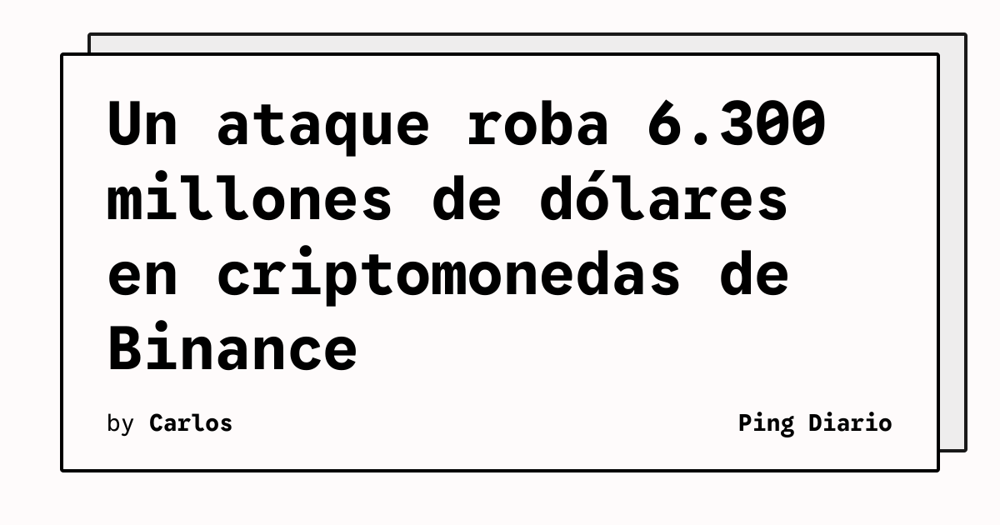

Binance informó del robo de aproximadamente 6.300 millones de dólares en criptomonedas, en un ataque que The Verge describe como el mayor incidente de este tipo registrado hasta ahora. La compañía afirmó que los fondos de sus usuarios están a salvo y que cerca de 3.000 millones de dólares de los activos afectados fueron congelados.

## Qué implica

La investigación inicial apuntó a un portátil comprometido, pero Binance comunicó posteriormente que había identificado más puntos de entrada. El incidente habría permitido acceder a un contenedor de servicio y enviar transacciones de retiro no autorizadas. Como respuesta, la plataforma suspendió depósitos y retiros y revocó la autorización de la dirección afectada.

Binance también declaró que cubrirá las pérdidas. La empresa mencionó una reserva de emergencia cercana a 1.300 millones de dólares y aseguró haber reservado más de 6.340 millones de fondos corporativos para responder al incidente.

## Hechos confirmados

- Binance comunicó un robo de unos 6.300 millones de dólares.
- La compañía afirmó que congeló aproximadamente 3.000 millones de dólares de activos afectados.
- El ataque involucró un portátil comprometido y el acceso a un contenedor de servicio, según la información publicada por la empresa.

## Análisis

El caso vuelve a mostrar que la seguridad de una plataforma financiera depende también de los equipos de desarrollo, los dispositivos de sus operadores y las identidades capaces de desplegar o ejecutar servicios. La segmentación de privilegios, la atestación de artefactos, la revisión de transacciones y la detección de actividad anómala deben cubrir la cadena completa, no solo las claves de las billeteras.

**Fuente:** [The Verge](https://www.theverge.com/tech/1023021/binance-hack-billions-biggest-crypto-heist).
