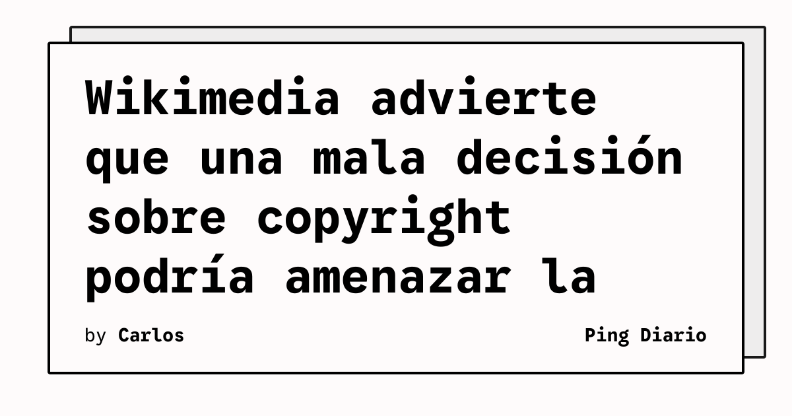

La Wikimedia Foundation presentó una posición intermedia en los litigios sobre inteligencia artificial y copyright que enfrentan a editores, OpenAI y Microsoft. La organización sostiene que entrenar modelos de lenguaje con material protegido puede constituir un uso legítimo, pero que los sistemas deberían respetar licencias cuando reproducen el contenido y sustituyen la consulta de la fuente original.

## Qué implica

Wikimedia señala que sus sitios son una fuente importante de datos para entrenar sistemas de inteligencia artificial, aunque esos mismos sistemas pueden reducir el tráfico que sostiene a las comunidades que mantienen Wikipedia. La fundación también destaca usos positivos de los modelos, como detectar vandalismo, localizar posibles infracciones y encontrar artículos que necesitan mejoras.

Su propuesta distingue entre utilizar obras para producir algo nuevo y entregar copias o fragmentos que reemplacen la relación del lector con el contenido original. En este segundo caso, considera necesario respetar las condiciones de licencia y atribuir correctamente las fuentes.

## Hechos confirmados

- Wikimedia presentó un escrito en casos relacionados con el uso de obras protegidas para entrenar modelos.
- La organización defiende una diferencia entre entrenamiento y respuestas que reproducen el contenido original.
- La fundación afirma que los modelos también pueden ayudar a mantener y mejorar sus proyectos colaborativos.

## Análisis

La discusión afecta directamente a la arquitectura de productos basados en recuperación y generación. No basta con evaluar si un modelo puede responder: también hay que controlar procedencia, atribución, licencias y el riesgo de que la respuesta sustituya por completo a la fuente. Para los equipos técnicos, esto convierte el registro de fuentes y las políticas de retención en componentes funcionales del sistema, no en un detalle legal posterior.

**Fuente:** [The Verge](https://www.theverge.com/policy/1022880/wikipedia-openai-new-york-times-copyright).
