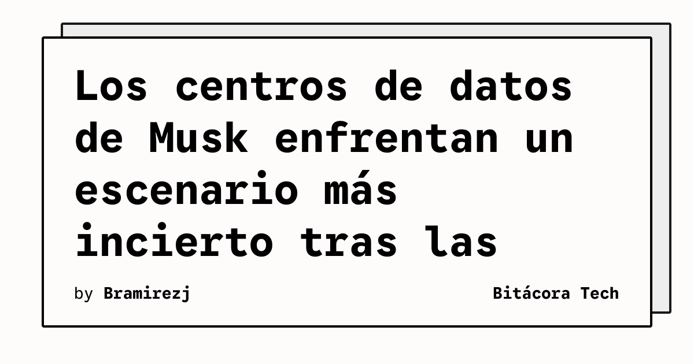

Los resultados de las elecciones de medio mandato abren un escenario más difícil para Elon Musk y sus centros de datos, según el análisis publicado por TechCrunch. El tema fue abordado en el podcast On Equity, donde el medio revisó qué significan los comicios para la industria tecnológica.

La nota no anuncia el cierre de una instalación ni un cambio técnico concreto en una plataforma. Su foco es el contexto: las señales políticas posteriores a las elecciones pueden modificar el entorno en el que se planifican inversiones intensivas en energía, conectividad y capacidad de cómputo.

## Qué implica

Los centros de datos dependen de decisiones que exceden la compra de servidores. Requieren permisos, energía disponible, redes, financiación y una relación estable con las autoridades locales y nacionales. Cuando cambia el escenario político, los equipos de infraestructura deben revisar supuestos sobre plazos, costes y expansión antes de convertir una proyección en capacidad contratada.

Para quienes operan cloud o infraestructura de IA, el caso también ilustra la importancia de separar capacidad comprometida de capacidad proyectada. Un entorno más incierto no prueba que un proyecto sea inviable, pero sí puede elevar la necesidad de escenarios, reservas de capacidad y seguimiento regulatorio. Esas medidas son prácticas de gestión de riesgo, no una conclusión específica sobre los activos de Musk.

## Hechos confirmados

- TechCrunch publicó un episodio de On Equity sobre las consecuencias de las elecciones de medio mandato para la industria tecnológica.
- El artículo sostiene que el panorama se vuelve más complicado para Elon Musk y los centros de datos.
- La fuente presenta el tema como un análisis de contexto, no como el anuncio de un cierre concreto.

## Análisis

La infraestructura de IA suele medirse en aceleradores y megavatios, pero su ejecución también depende del contexto institucional. Seguir permisos, acceso a energía y señales políticas debería formar parte del mismo tablero operativo que la latencia y la disponibilidad. La magnitud de ese efecto todavía requiere datos específicos por proyecto.

**Fuente:** [TechCrunch](https://techcrunch.com/2026/11/07/after-the-midterms-things-are-looking-rocky-for-elon-musk-and-data-centers/).
