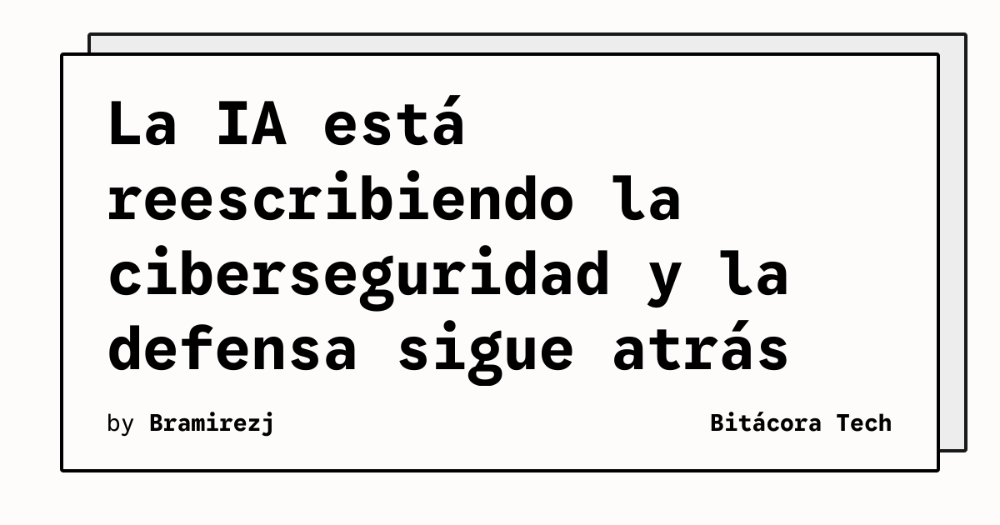

La inteligencia artificial ya no es solo una herramienta de productividad para los equipos de seguridad. En una conversación publicada por The Verge, Alex Stamos, director de seguridad de Cognition y especialista en ciberseguridad, describe un escenario en el que la IA acelera las oleadas de hackeos, brechas y ataques mientras la defensa permanece rezagada.

El episodio forma parte de una serie especial sobre IA en la vida real. El planteamiento central es concreto: tanto los Estados como grupos pequeños de atacantes pueden aprovechar estas capacidades, y el desequilibrio entre ataque y defensa está presionando a una industria que durante años construyó sus procesos alrededor de amenazas más lentas.

## Qué implica

Para los equipos técnicos, el cambio no consiste únicamente en añadir un asistente a la consola del SOC. Si las campañas maliciosas se pueden preparar y adaptar con mayor rapidez, la detección tendrá que reducir también el tiempo entre una señal, una investigación y una respuesta. La automatización defensiva deberá mantener trazabilidad y controles humanos, especialmente cuando una alerta pueda activar acciones sobre sistemas productivos.

La entrevista no presenta una lista de productos ni una solución cerrada. Sí fija una prioridad operativa: medir si las defensas pueden responder al ritmo de los ataques que las herramientas de IA hacen posibles. Esa pregunta afecta a la observabilidad, la gestión de identidades, la respuesta a incidentes y la preparación de los equipos.

## Hechos confirmados

- The Verge entrevistó a Alex Stamos sobre el impacto de la IA en la ciberseguridad.
- Stamos es presentado como director de seguridad de Cognition y experto de larga trayectoria en seguridad.
- La conversación aborda cómo la IA habilita a Estados y grupos pequeños, además de una defensa que va por detrás.

## Análisis

La señal más importante no es que la IA elimine la ciberseguridad, sino que comprime sus tiempos. Las organizaciones que todavía dependen de revisiones manuales y respuestas lineales podrían acumular más exposición. Es una hipótesis operativa, no una predicción: conviene validarla con ejercicios de respuesta y métricas de tiempo real.

**Fuente:** [The Verge](https://www.theverge.com/podcast/1029038/ai-cybersecurity-hackers-data-breach-dark-age-alex-stamos).
