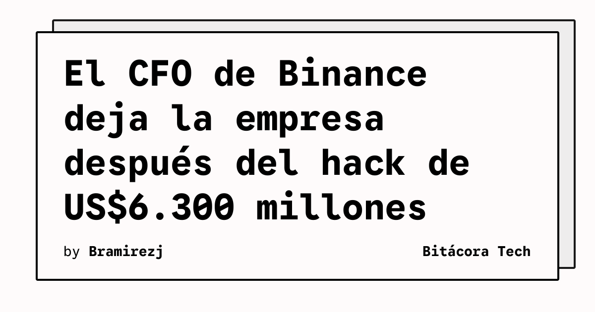

El director financiero de Binance dejará su cargo para «perseguir una nueva aventura», según informó TechCrunch. El anuncio llega poco más de una semana después de que hackers robaran US$6.300 millones en criptomonedas a usuarios de la plataforma, de acuerdo con la información publicada por el medio.

La noticia conecta una decisión ejecutiva con un incidente de seguridad de escala extraordinaria. El artículo no presenta la salida como una explicación técnica del ataque, pero sí sitúa ambos hechos en una misma secuencia temporal: primero el robo y, apenas más de una semana después, el anuncio del cambio en la dirección financiera.

## Qué implica

Los incidentes de esta magnitud no terminan cuando se contiene la intrusión. También abren preguntas sobre continuidad ejecutiva, controles financieros, comunicación de crisis y capacidad de recuperar la confianza de los usuarios. Para cualquier plataforma que custodie activos, la seguridad debe convivir con procesos verificables de autorización, segregación de funciones y respuesta ante movimientos anómalos.

El caso recuerda que la gobernanza y la ciberseguridad no son capas separadas. Un ataque puede convertirse rápidamente en un problema operativo y de liderazgo, incluso cuando la investigación técnica todavía está en curso. La prioridad para los equipos debería ser documentar qué ocurrió, qué controles fallaron y qué medidas son comprobables, sin reemplazar esos datos por declaraciones genéricas.

## Hechos confirmados

- TechCrunch informó que el CFO de Binance dejará la empresa para emprender un nuevo proyecto.
- El anuncio ocurrió poco más de una semana después del hack mencionado por el medio.
- TechCrunch cifra en US$6.300 millones las criptomonedas robadas a usuarios de Binance.

## Análisis

La salida no permite, por sí sola, atribuir responsabilidades ni demostrar una relación causal con el ataque. Sí muestra cómo un incidente de seguridad puede trasladarse al nivel de gobierno corporativo. La lectura prudente es exigir evidencia de controles y de recuperación antes de valorar cualquier promesa de normalización.

**Fuente:** [TechCrunch](https://techcrunch.com/2026/11/07/binance-cfo-is-leaving-to-pursue-a-new-venture-after-6-3-billion-hack/).
