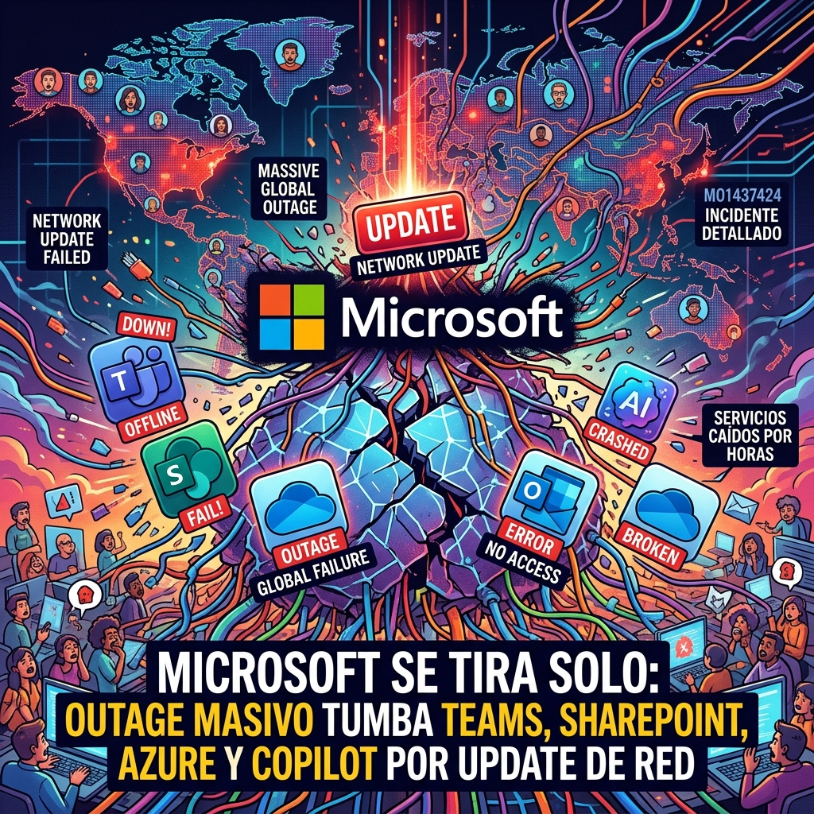

## La noticia principal

TechCrunch y The Verge reportan la misma interrupción de servicios de Microsoft, con usuarios que no podían acceder con normalidad a Outlook y otros productos. Se trata de un único incidente editorial, no de dos noticias distintas: ambas fuentes se agrupan aquí para evitar duplicar el reporte.

Al cierre de esta publicación no había una confirmación oficial accesible que permitiera establecer la causa, el alcance exacto o la recuperación completa. Por eso no atribuimos una causa ni presentamos como hechos los detalles que no estén confirmados.

> **Alerta operativa:** estado **sin mitigación confirmada**. No hay una medida de recuperación validada públicamente para recomendar; los equipos afectados deben consultar sus canales de soporte y su página de estado habitual.

## Fuentes y límites

- [TechCrunch: Microsoft's Outlook email hit by new outage](https://techcrunch.com/2026/11/12/microsofts-outlook-email-hit-by-new-outage/)
- [The Verge: cobertura de la interrupción de Microsoft](https://www.theverge.com/news/2026/11/12/microsoft-outlook-outage)

La información anterior describe lo reportado por esas dos fuentes. La confirmación oficial de Microsoft no estaba disponible de forma accesible al momento de redactar.
