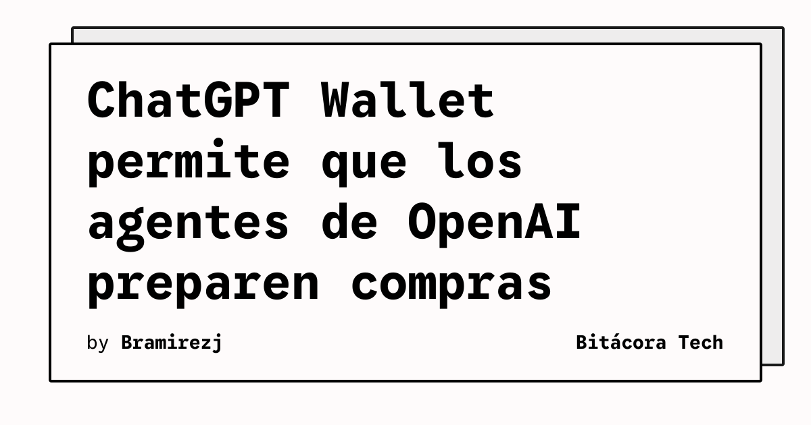

OpenAI lanzó ChatGPT Wallet, una función que permite a sus agentes Dots preparar compras con tarjetas de crédito o débito. Según The Verge, el despliegue inicial está dirigido a suscriptores de ChatGPT Pro en Estados Unidos mayores de 18 años, con dirección de facturación estadounidense y tarjetas elegibles de American Express, Chase, Mastercard y Visa.

El agente puede responder a una instrucción del usuario y avanzar hasta el momento de pagar. El usuario debe revisar la compra y aprobarla antes de que se complete. La página de soporte de OpenAI citada por The Verge añade una comprobación de seguridad biométrica, como Face ID o una huella dactilar, en cada compra.

## Qué implica

La propuesta convierte al agente en una interfaz operativa para el comercio electrónico, no solo en un sistema de recomendaciones. El control sigue en manos del usuario en el despliegue descrito, pero el flujo concentra en un mismo punto la intención de compra, la autenticación y el pago.

OpenAI afirma que utiliza un token de pago después de la aprobación. De ese modo, los datos reales de la tarjeta no se comparten con el agente ni con el comercio. La disponibilidad también depende de que los sitios acepten agentes y de que sus sistemas de pago y riesgo reconozcan esas transacciones.

## Hechos confirmados

- ChatGPT Wallet se está desplegando inicialmente para usuarios Pro elegibles en Estados Unidos.
- Los agentes Dots pueden preparar compras, pero deben pedir aprobación antes de finalizar.
- OpenAI describe verificaciones biométricas y sustitución de los datos de tarjeta por un token.
- La compañía plantea controles futuros como límites de gasto, categorías y periodos.

## Análisis

El valor técnico de la función dependerá menos de la conversación y más de la interoperabilidad con comercios y sistemas antifraude. La aprobación explícita reduce el riesgo de compras inesperadas, aunque no elimina los problemas de autorización, errores del agente o disputas. Para equipos que diseñen agentes comerciales, el modelo refuerza la necesidad de permisos acotados, trazabilidad y límites configurables.

**Fuente:** [The Verge](https://www.theverge.com/ai-artificial-intelligence/1033425/openai-chatgpt-wallet), acceso de pago.
