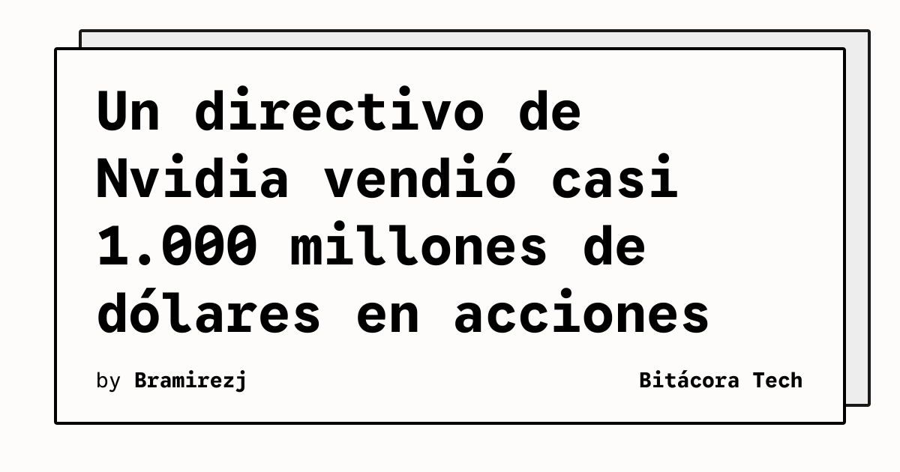

Yahoo Finance informa que un directivo de Nvidia vendió acciones por un valor cercano a 1.000 millones de dólares semanas antes de que trascendieran informaciones sobre un escándalo relacionado con Jensen Huang. El artículo señala que no se identificó un plan de negociación para esa operación en los datos revisados por la publicación.

La noticia llega en un momento de alta sensibilidad para Nvidia. La empresa ocupa una posición central en el suministro de aceleradores para inteligencia artificial, por lo que las operaciones de sus ejecutivos pueden atraer una atención especial de inversores y reguladores. La existencia de una venta, por sí sola, no demuestra uso de información privilegiada ni una infracción.

## Qué implica

Para el mercado, el dato principal es la proximidad temporal entre una operación de gran tamaño y la publicación posterior de informaciones sobre la dirección de la compañía. Esa proximidad puede alimentar preguntas sobre controles internos, divulgación y políticas de negociación de ejecutivos.

Sin embargo, una interpretación responsable requiere separar tres hechos: la venta reportada, el momento en que se ejecutó y la información que conocía el directivo al decidirla. El artículo consultado no equivale a una conclusión de la autoridad bursátil ni prueba que la operación estuviera vinculada al escándalo.

## Hechos confirmados

- Yahoo Finance publicó que un directivo de Nvidia vendió casi 1.000 millones de dólares en acciones.
- El artículo sitúa la operación semanas antes de que emergieran informaciones sobre Jensen Huang.
- La publicación indica que no se señaló un plan de negociación para esa venta.
- El artículo no presenta una resolución regulatoria que determine una infracción.

## Análisis

La consecuencia más inmediata es reputacional: los inversores pueden exigir mayor claridad sobre las ventanas de negociación y las autorizaciones internas. Antes de extraer una conclusión legal, conviene esperar documentos regulatorios, registros completos de la operación y una respuesta de Nvidia. El tamaño de la venta hace que el caso sea relevante para la gobernanza de compañías tecnológicas, pero no reemplaza la evidencia sobre la intención del directivo.

**Fuente:** [Yahoo Finance](https://finance.yahoo.com/markets/stocks/articles/nvidia-director-sold-nearly-1b-160000846.html), acceso parcialmente limitado.
