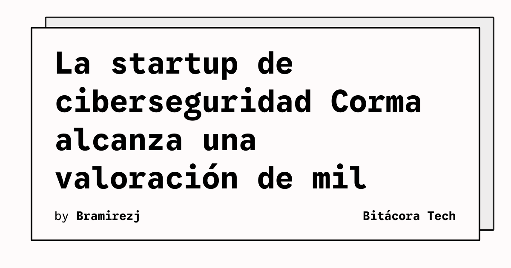

Corma, una startup de ciberseguridad basada en inteligencia artificial, alcanzó una valoración de mil millones de dólares aproximadamente tres meses después de presentar su producto. TechCrunch informa que la compañía captó 125 millones de dólares en una ronda Serie A liderada por NEA.

La rapidez de la operación destaca en un mercado donde las empresas de seguridad intentan convertir modelos de IA en herramientas capaces de detectar, priorizar y responder a amenazas. El dato disponible confirma la ronda, el inversor principal y la valoración; no describe por sí solo el rendimiento técnico del producto ni demuestra que la startup haya resuelto los problemas más difíciles de la operación de seguridad.

## Qué implica

Una ronda de ese tamaño tan pronto después del lanzamiento pone presión sobre la empresa para demostrar que su crecimiento financiero se corresponde con adopción y resultados medibles. En ciberseguridad, esos resultados suelen depender de la calidad de las señales, la integración con los sistemas existentes y la reducción de falsos positivos, no solo de la capacidad del modelo.

También revela la disposición del capital de riesgo a financiar compañías que sitúan la IA en el centro de su propuesta de seguridad. Para los compradores, la valoración no debería sustituir a pruebas independientes: será necesario evaluar protección de datos, explicabilidad, controles de acceso y la forma en que el producto funciona durante un incidente real.

## Hechos confirmados

- TechCrunch identifica a Corma como una startup de ciberseguridad con IA.
- La compañía levantó 125 millones de dólares en una ronda Serie A.
- NEA lideró la ronda y la valoración comunicada alcanzó mil millones de dólares.
- La operación ocurrió cerca de tres meses después de la presentación del producto.

## Análisis

La ronda puede acelerar la contratación y la expansión comercial de Corma, pero todavía no permite medir su impacto defensivo. En un sector tan sensible, la siguiente señal importante no será otra cifra de financiación, sino evidencia reproducible de que la herramienta ayuda a detectar y contener ataques sin añadir una carga operativa imposible de sostener.

**Fuente:** [TechCrunch](https://techcrunch.com/2026/11/16/cybersecurity-ai-startup-corma-reaches-1b-valuation-in-about-3-months/).
