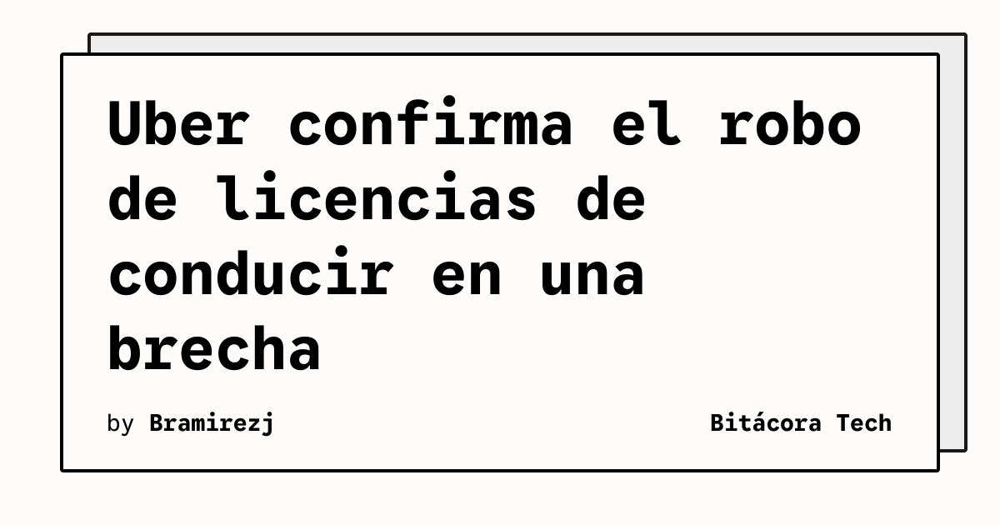

Uber informó que atacantes robaron información de cerca de 150.000 licencias de conducir durante un incidente de seguridad. TechCrunch señala que los datos estaban almacenados por Fireworks AI, una compañía de infraestructura de inteligencia artificial utilizada por Uber.

El hecho conecta una brecha de datos personales con una dependencia de la cadena tecnológica de IA. El número comunicado se refiere a licencias de conductores y la noticia atribuye la información a Uber. La existencia de un proveedor no cambia la responsabilidad de supervisar dónde se almacenan los datos, cómo se protegen y qué accesos permanecen activos.

## Qué implica

La exposición de una licencia de conducir puede facilitar suplantaciones y aumentar el riesgo para las personas afectadas, aunque el artículo fuente no cuantifica esos efectos. Para los equipos de seguridad, el incidente refuerza la necesidad de mantener un inventario preciso de datos sensibles en proveedores externos, limitar el acceso por función y revisar los registros de actividad con criterios que permitan detectar extracciones anómalas.

Las organizaciones que integran servicios de IA suelen concentrarse en el modelo y la latencia. Este caso recuerda que la superficie de riesgo también incluye almacenamiento, credenciales, copias, entornos de prueba y rutas de soporte. La evaluación de un proveedor debe cubrir esos elementos antes de trasladar información identificable a su infraestructura.

Además, una respuesta completa debe separar el alcance confirmado de las hipótesis. La compañía debe comunicar qué registros fueron afectados, durante qué periodo estuvieron expuestos y qué medidas ofrece a las personas afectadas. Sin esos datos, no es posible calcular el riesgo individual con precisión ni saber si la contención alcanzó a todas las copias.

## Hechos confirmados

- Uber comunicó el robo de información de cerca de 150.000 licencias de conducir.
- El incidente fue descrito como una brecha de datos.
- La información estaba almacenada por Fireworks AI.
- TechCrunch identificó a Fireworks AI como una empresa de nube para IA.

## Análisis

La dependencia de proveedores puede mejorar la velocidad de desarrollo, pero distribuye la responsabilidad técnica entre más sistemas. Una práctica razonable es exigir evidencia de controles, segmentar los datos y preparar una revocación rápida de accesos. La seguridad de la IA no termina en el modelo: incluye cada repositorio que conserva los datos que el modelo o la aplicación necesita.

**Fuente:** [TechCrunch](https://techcrunch.com/2026/11/16/uber-confirms-hackers-stole-thousands-of-drivers-license-information-in-data-breach/).
