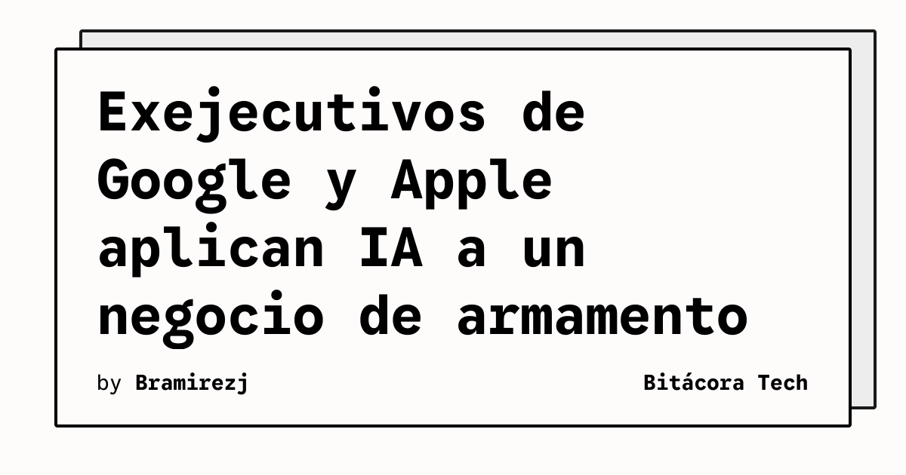

La experiencia acumulada en compañías de software y en el diseño de dispositivos móviles está llegando a un sector muy distinto: la fabricación de municiones. Wired informa que Chad Steelberg y Andy Baynes, antiguos ejecutivos vinculados con Google y Apple, están aplicando sus conocimientos empresariales y técnicos a la construcción de un negocio de armamento con una valoración potencial de mil millones de dólares.

La historia no presenta la IA como una función aislada de un producto de consumo. La describe como parte de una estrategia industrial que combina automatización, fabricación y software en un ámbito donde los errores tienen consecuencias físicas. El artículo fuente identifica a los dos fundadores y sitúa su propuesta en la manufactura de municiones letales.

## Qué implica

El caso muestra cómo la experiencia de las grandes tecnológicas puede trasladarse a industrias reguladas y sensibles. La ventaja no estaría solo en entrenar un modelo, sino en coordinar equipos, iterar productos y convertir datos operativos en decisiones de producción. Ese traslado de capacidades también lleva al sector defensa debates habituales de la industria digital: trazabilidad, controles, seguridad y responsabilidad.

Para los equipos técnicos, el punto relevante es que la frontera entre una startup de software y una empresa industrial se vuelve menos nítida. La IA puede formar parte de la cadena de diseño o fabricación, pero la fuente no permite afirmar qué modelos, datos o procesos concretos utiliza la compañía. Es importante no confundir la presencia de perfiles tecnológicos con una descripción detallada de la arquitectura.

## Hechos confirmados

- Wired identifica a Chad Steelberg y Andy Baynes como antiguos ejecutivos de Google y Apple.
- Ambos están aplicando su experiencia en empresas de software y diseño de iPhone a la fabricación de municiones.
- El artículo describe el negocio como una empresa de armamento con una valoración de mil millones de dólares.

## Análisis

La noticia apunta a una tendencia plausible: el capital y el talento de la IA están buscando aplicaciones fuera del software empresarial. En defensa, sin embargo, la velocidad de iteración no puede ser el único criterio. La gobernanza del dato, la supervisión humana y la responsabilidad por el resultado deberían pesar tanto como la eficiencia prometida.

**Fuente:** [Wired](https://www.wired.com/story/ai-told-these-ex-google-guys-how-to-build-a-billion-dollar-weapons-business/).
