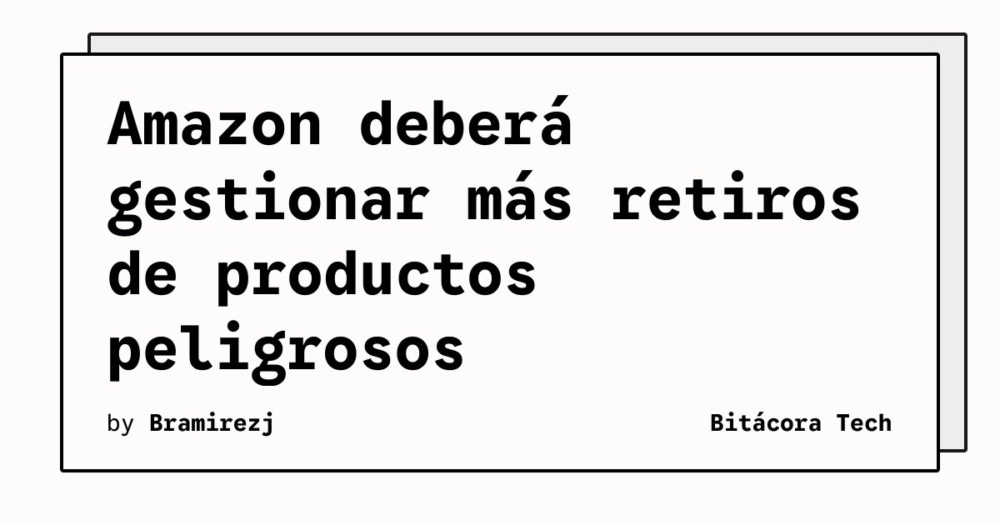

Amazon perdió una disputa legal que puede ampliar sus obligaciones sobre productos vendidos por terceros. Según The Verge, el Tribunal de Distrito de Estados Unidos para Maryland falló a favor de la Comisión de Seguridad de Productos del Consumidor, conocida como CPSC, en una causa sobre artículos distribuidos mediante el programa «Fulfilled by Amazon».

La CPSC había ordenado a Amazon retirar más de 400.000 productos considerados peligrosos. La empresa sostuvo que actuaba como proveedor logístico, mientras que la comisión argumentó que Amazon era un distribuidor y debía encargarse del proceso de retiro. El tribunal respaldó la segunda interpretación.

## Qué implica

Un retiro de producto no termina al identificar una oferta. También exige localizar unidades, comunicar el riesgo, coordinar devoluciones y mantener trazabilidad sobre lo ocurrido. Cuando el catálogo combina inventario propio con productos de terceros, la plataforma necesita sistemas capaces de relacionar cada anuncio con un vendedor, un lote y un historial de comunicaciones.

El fallo puede aumentar la carga operativa de los marketplaces que intermedian productos físicos. Las herramientas de cumplimiento, los controles de publicación y la conservación de registros dejan de ser funciones auxiliares: pueden formar parte de la capacidad de la plataforma para responder ante un riesgo de seguridad. También facilitan demostrar qué medidas se tomaron.

## Hechos confirmados

- El tribunal falló a favor de la CPSC en la disputa contra Amazon.
- La orden afecta a más de 400.000 productos gestionados mediante «Fulfilled by Amazon».
- Entre los ejemplos mencionados figuran detectores de monóxido de carbono defectuosos, secadores sin protección contra electrocución y productos infantiles.

## Análisis

La decisión desplaza parte del debate desde la logística hacia la responsabilidad de distribución. También obliga a revisar cómo se informa al comprador cuando un producto cambia de estado después de la venta. Para un marketplace, la escala del catálogo no elimina la necesidad de saber qué producto se ofreció, quién lo vendió y cómo retirar sus unidades. El resultado puede incentivar controles más rigurosos, aunque el alcance práctico dependerá de cómo se aplique el fallo y de las obligaciones específicas que se establezcan en cada caso.

**Fuente:** [The Verge](https://www.theverge.com/tech/1042870/amazon-recall-order-cpsc).
