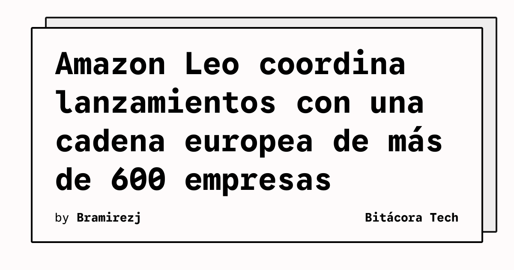

Los lanzamientos de Amazon Leo dependen de una cadena industrial que atraviesa Europa antes de llegar al puerto espacial de Kourou, en la Guayana Francesa. Según la publicación de Amazon, más de 600 empresas europeas participan en la fabricación de los cohetes que transportan los satélites de la constelación.

El artículo describe una coordinación que incluye estructuras, aviónica, cableado, sistemas de propulsión, integración y operaciones de lanzamiento. La noticia no presenta una pieza única como protagonista: muestra cómo un programa de conectividad orbital se apoya en una red distribuida de proveedores y especialistas.

## Qué implica

El reto técnico no termina con la fabricación del satélite. Cada lanzamiento requiere adaptar el cohete y su plan de vuelo a una misión concreta. Amazon explica que la preparación específica suele comenzar entre seis y diez meses antes del despegue, mientras que algunos componentes de plazos largos se planifican con dos o tres años de antelación.

ArianeGroup utiliza un modelo digital compartido del cohete para que los proveedores puedan diseñar sus componentes con visibilidad sobre el vehículo completo. Ese mecanismo reduce el riesgo de que cada empresa optimice una pieza sin conocer las restricciones de integración del conjunto.

## Hechos confirmados

- Más de 600 empresas europeas participan en la cadena de fabricación asociada a los lanzamientos de Amazon Leo.
- El cableado interno de un Ariane 6 alcanza unos 30 kilómetros, según el artículo.
- Amazon Leo y Arianespace ampliaron en septiembre su acuerdo con seis lanzamientos Ariane 6 adicionales, hasta un total contratado de 24.
- Los componentes se ensamblan en distintos puntos de Europa y se transportan a la Guayana Francesa a bordo del buque Canopée.

## Análisis

La noticia ilustra que la escalabilidad de una constelación depende tanto de la capacidad de producción como de la coordinación entre empresas. La visibilidad de una cartera de lanzamientos puede ayudar a planificar materiales, personal e inversiones, pero también aumenta la dependencia de una cadena con muchos puntos de integración. Para un servicio de conectividad, la cadencia orbital y la disponibilidad de la red son problemas de ingeniería y de operaciones al mismo tiempo.

**Fuente:** [Amazon](https://www.aboutamazon.com/news/amazon-leo/amazon-leo-ariane-space?utm_source=rss).
