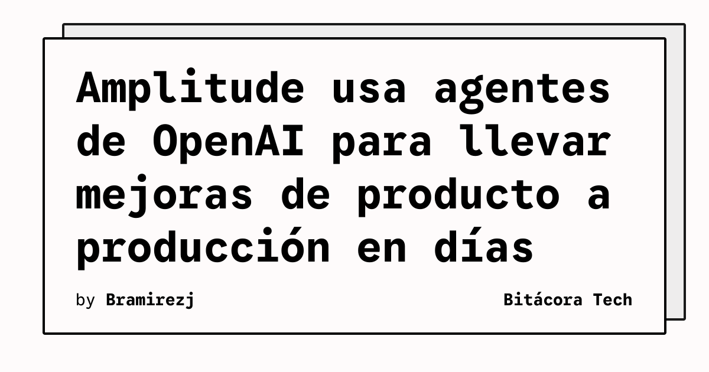

Amplitude presentó cómo usa su agente proactivo Wave, construido principalmente sobre modelos de OpenAI, para detectar oportunidades de producto y ayudar a convertirlas en cambios desplegables. En el caso descrito por OpenAI, la empresa estima que puede llevar una mejora desde el análisis hasta el envío en uno o dos días, frente a aproximadamente un mes en su proceso anterior.

Wave reúne datos de Amplitude, reproducciones de sesiones, comentarios de clientes y código. Con esa información identifica oportunidades, prepara un plan técnico y criterios de aceptación, y puede entregar el trabajo a agentes de programación como Codex. Después mide el resultado para que el siguiente ciclo parta de evidencia de uso y no solo de una hipótesis del equipo.

## Qué implica

El cambio no consiste únicamente en pedirle código a un modelo. La propuesta de Amplitude conecta descubrimiento, implementación y medición en un mismo flujo. Esa integración reduce el salto entre detectar un problema y probar una solución, aunque mantiene decisiones humanas para cambios de mayor alcance.

En una prueba sobre la página de inicio de Amplitude, Wave detectó que la mayoría de las personas escribía sus propias preguntas en lugar de elegir tarjetas de sugerencias. La empresa personalizó esas tarjetas con contexto reciente y realizó una prueba A/B. Según el informe publicado por OpenAI, los mensajes enviados mediante esas tarjetas aumentaron un 160 por ciento frente al control después de un día.

## Hechos confirmados

- Wave está construido aproximadamente en un 80 por ciento sobre modelos de OpenAI, según Amplitude.
- La empresa estima un plazo de uno a dos días para enviar una mejora de producto con este flujo.
- En la prueba de las tarjetas de sugerencias, Amplitude reportó un aumento del 160 por ciento frente al control después de un día.
- Los equipos pueden enviar a agentes de programación un plan técnico y criterios de aceptación, manteniendo revisión humana para funcionalidades nuevas y apuestas mayores.

## Análisis

La parte más interesante es el circuito de retroalimentación: el agente no solo genera una propuesta, sino que ayuda a medir si la modificación produjo el efecto buscado. Eso puede acortar la distancia entre analítica y desarrollo, pero también exige experimentos bien diseñados y controles sobre los datos que entran al proceso. La velocidad anunciada será útil únicamente si la calidad de la medición evita convertir más despliegues en más ruido.

**Fuente:** [OpenAI](https://openai.com/business/customer-stories/amplitude/).
