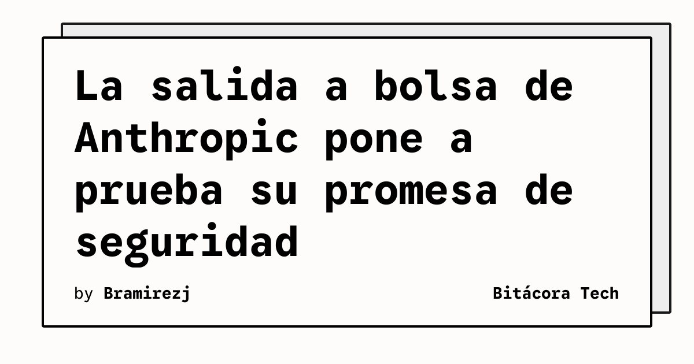

Anthropic salió a bolsa en el Nasdaq y se convirtió, según The Verge, en el primer laboratorio de IA pura en cotizar públicamente. La operación coloca bajo una nueva luz su promesa de desarrollar una IA segura: ahora la empresa también debe responder ante accionistas y sostener el coste creciente de entrenar y operar modelos avanzados.

La noticia fue analizada en un episodio de *Decoder* con Hayden Field, reportera sénior de IA de The Verge. El artículo describe la oferta pública inicial como un caso de tensión entre control corporativo, crecimiento y seguridad. Anthropic fijó el precio inicial en 83 dólares por acción y llegó a 111 dólares durante la primera jornada citada por la publicación.

## Qué implica

Para los equipos técnicos, el cambio no es solo financiero. Un laboratorio que vende su propuesta alrededor de la seguridad debe convertir esa prioridad en decisiones visibles sobre investigación, evaluación, despliegue y uso de recursos. La cotización añade presión para demostrar crecimiento, pero también hace más observables las decisiones de gobierno corporativo y las promesas dirigidas a clientes empresariales.

The Verge señala que la estructura de Anthropic conserva más influencia de sus fundadores de la que podría sugerir una empresa pública. El artículo relaciona ese diseño con la forma en que el laboratorio intenta limitar las presiones de corto plazo. No obstante, la existencia de mecanismos de control no elimina por sí sola el conflicto entre invertir en seguridad y financiar las necesidades de cómputo.

## Hechos confirmados

- Anthropic se convirtió en el primer laboratorio de IA pura en salir a bolsa, según el artículo de The Verge.
- La oferta se fijó en 83 dólares por acción y la cotización llegó a 111 dólares durante la jornada descrita.
- La cobertura examina la estructura de gobierno de la empresa, la influencia de sus fundadores y el coste de mantener el desarrollo de modelos avanzados.
- La publicación identifica una tensión entre la marca de IA segura de Anthropic y las exigencias de crecimiento de una compañía cotizada.

## Análisis

La salida a bolsa no demuestra por sí misma que la burbuja de la IA vaya a continuar ni que vaya a estallar. Sí convierte la estrategia de Anthropic en un caso especialmente útil para observar cómo una empresa puede financiar infraestructura intensiva sin rebajar sus compromisos de seguridad. La prueba relevante será si esas prioridades aparecen en productos, controles y decisiones de inversión, no solo en la comunicación corporativa.

**Fuente:** [The Verge](https://www.theverge.com/podcast/1038701/anthropic-ipo-ai-safety-openai-nvidia-structure).
