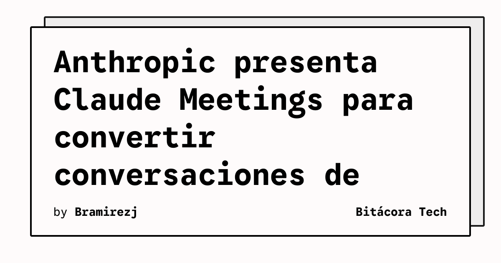

Anthropic presentó Claude Meetings, una función que busca convertir las conversaciones de trabajo en planes y tareas. Según la información publicada por TechCrunch, mientras los participantes hablan Claude puede redactar el plan que se está discutiendo, organizar una línea temporal en una pizarra y responder preguntas en el chat de la reunión.

La propuesta amplía el papel del asistente: no se limita a resumir una conversación después de que termina, sino que participa en la organización del trabajo mientras ocurre. TechCrunch también señala que Claude puede acceder a aplicaciones conectadas para recuperar información, como las cifras del año anterior. La noticia fue publicada el 10 de noviembre de 2026 y el feed la clasificó como de alta prioridad.

## Qué implica

La utilidad principal está en reducir el trabajo posterior a una reunión. Si el sistema mantiene un plan actualizado, el equipo puede salir con una secuencia de tareas y un calendario inicial en vez de reconstruirlos desde notas dispersas. El acceso a aplicaciones conectadas añade contexto, aunque también hace más importante revisar qué información puede consultar el asistente y quién recibe sus resultados.

La fuente describe capacidades de redacción, planificación, chat y consulta de aplicaciones, pero no aporta en esta publicación una medida independiente de precisión ni garantiza que las decisiones queden correctamente interpretadas. Las organizaciones deberán tratar los planes generados como propuestas revisables, especialmente cuando incluyan cifras o compromisos.

## Hechos confirmados

- Claude Meetings puede redactar el plan de una conversación mientras se desarrolla.
- La herramienta puede representar una línea temporal en una pizarra y responder preguntas en el chat.
- Claude puede consultar aplicaciones conectadas para recuperar información, incluidas cifras del año anterior.

## Análisis

El cambio más relevante es de flujo de trabajo: la reunión pasa a ser una fuente estructurada de tareas y contexto. Para que eso sea sostenible, los equipos necesitarán permisos acotados, registros de las fuentes consultadas y una persona responsable de validar el resultado. La automatización puede ahorrar tiempo, pero no sustituye la confirmación de acuerdos ni la revisión de datos sensibles.

**Fuente:** [TechCrunch](https://techcrunch.com/2026/11/10/anthropic-launches-claude-meetings-to-turn-workplace-discussions-into-plans-and-tasks/).
