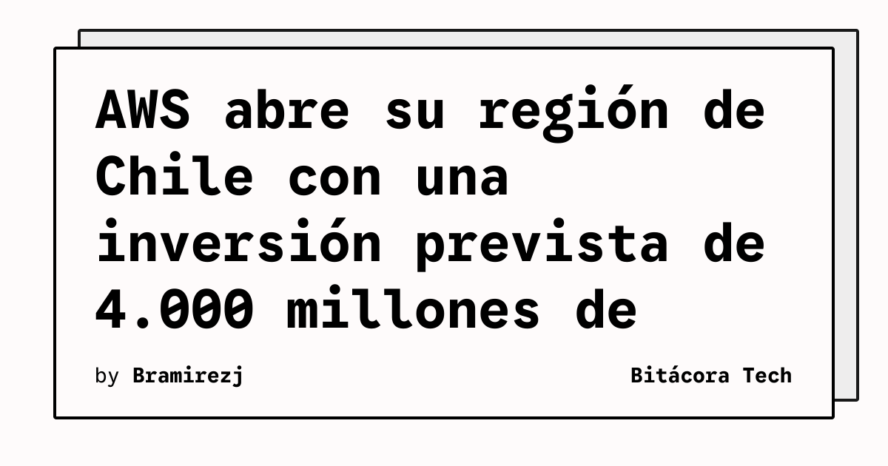

Amazon Web Services abrió a clientes seleccionados su región Sudamérica (Chile), la primera infraestructura regional de AWS en el país y la tercera de la compañía en Latinoamérica. Amazon informó que la región está operativa en acceso anticipado y que espera habilitar la disponibilidad general antes de terminar 2026.

## Qué implica

La apertura permite que organizaciones seleccionadas comiencen a usar infraestructura de AWS localizada en Chile. Para equipos técnicos, una región propia puede facilitar decisiones sobre residencia de datos, latencia y arquitectura de continuidad, aunque el beneficio concreto dependerá de los servicios disponibles y de los requisitos de cada carga.

Amazon prevé invertir más de 4.000 millones de dólares para respaldar la región. Según las estimaciones publicadas por la compañía, el proyecto contribuiría con más de 7.500 millones de dólares al PIB chileno y sostendría un promedio anual de 4.100 empleos equivalentes a tiempo completo, incluidos puestos en telecomunicaciones, construcción, generación eléctrica y operación de centros de datos.

## Hechos confirmados

- La región AWS Sudamérica (Chile) ya está operativa para un grupo seleccionado de clientes.
- La disponibilidad general está prevista para las próximas semanas y, en el anuncio, para antes del cierre de 2026.
- AWS estima una inversión superior a 4.000 millones de dólares en Chile.
- La compañía afirma haber formado a más de 200.000 personas en habilidades cloud en Chile desde 2017 y apunta a 300.000 estudiantes para 2028.

## Análisis

La región añade una opción local a las arquitecturas cloud que operan en Sudamérica y puede reducir la necesidad de ubicar ciertas cargas fuera de Chile. No obstante, la decisión de migrar no debería basarse solo en la proximidad geográfica: conviene comprobar precios, catálogo regional, acuerdos de nivel de servicio, conectividad y requisitos de recuperación ante desastres cuando se publique la disponibilidad general.

**Fuente:** [Amazon](https://www.aboutamazon.com/news/aws/aws-south-america-chile-region-launch?utm_source=rss).
