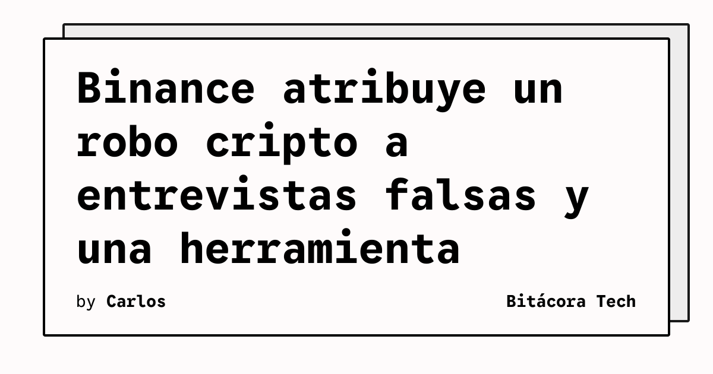

Un informe posterior al incidente de Binance describe una intrusión que combinó malware, ingeniería social y acceso a una herramienta interna de inteligencia artificial. The Verge señala que el robo de criptomonedas alcanzó los 6.300 millones de dólares y que el ataque se desarrolló durante varios meses.

## Qué implica

El caso muestra cómo una cadena de fallos puede ser más determinante que una única vulnerabilidad. Según el informe de Binance citado por The Verge, un desarrollador descargó en junio un instalador manipulado que aparentemente se distribuyó mediante un anuncio malicioso en un buscador. La intrusión expuso información sobre los ingenieros y su forma de trabajo.

En septiembre, otro ingeniero fue contactado por una persona que fingía estar interesada en contratarlo. El atacante organizó llamadas y varias rondas de entrevistas para construir confianza, y después envió una tarea que en realidad contenía malware. La técnica trasladó el riesgo desde el perímetro técnico hacia un proceso cotidiano de selección.

## Hechos confirmados

- Binance afirma que detectó la primera instalación de malware en junio y sustituyó el dispositivo afectado.
- The Verge informa que una segunda intrusión eliminó el ejecutable `pyenv` y lo reemplazó por una versión maliciosa con acceso de puerta trasera.
- El informe de Binance atribuye al grupo norcoreano «TraderTraitor» el uso posterior de la herramienta interna de IA para controlar carteras.
- Binance sostiene que congeló o interceptó unos 2.850 millones de dólares en activos robados y que había repuesto el 98 % de los tokens afectados al publicarse el artículo.

La compañía también afirmó que su protección de endpoints no detectó el malware de día cero. El artículo indica que la operación incluyó técnicas de ofuscación y evasión, además de acciones para ocultar la actividad y borrar rastros.

## Análisis

El incidente refuerza la necesidad de tratar las entrevistas técnicas, las descargas de código y las herramientas internas como superficies de ataque conectadas. La automatización basada en IA no elimina los controles de identidad ni la revisión de autorizaciones: si una cuenta comprometida puede operar sobre carteras, el modelo de amenazas debe contemplar también el abuso de esa herramienta.

**Fuente:** [The Verge](https://www.theverge.com/news/1025576/binance-cyrpto-theft-explained), acceso de pago.
