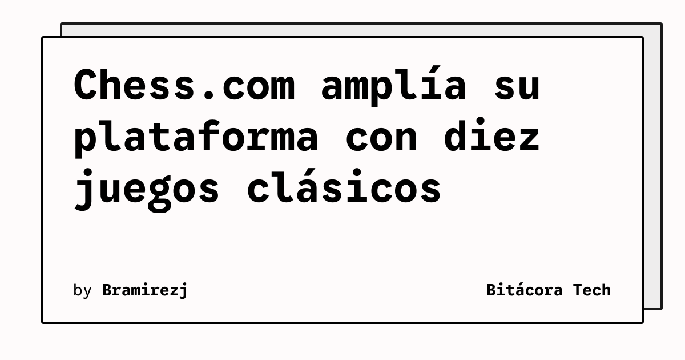

Chess.com está probando una plataforma que extiende su producto más allá del ajedrez. Classic Games incorpora diez juegos adicionales: backgammon, damas, go, hearts, mahjong, shogi, sudoku, solitario, xiangqi y «word», una alternativa a Scrabble. La beta pública se lanza en la web y mediante una nueva aplicación para iOS y Android, según The Verge.

La expansión busca aplicar a otros juegos la infraestructura comunitaria que Chess.com ya utiliza para el ajedrez. El producto incluye lecciones, tablas de clasificación y sistemas de puntuación. En los juegos multijugador también ofrece partidas contra otras personas o contra bots. Sudoku dispone de cuadrículas diarias, mientras que solitario incluye repartos diarios y otros títulos incorporan retos o rompecabezas.

## Qué implica

Desde el punto de vista de producto, Classic Games reutiliza una identidad técnica conocida en lugar de crear una aplicación aislada para cada juego. La plataforma conserva patrones de aprendizaje, competición y seguimiento que ya resultan familiares para sus usuarios. Esa decisión puede reducir la fricción de entrada, aunque también obliga a adaptar reglas y modos de juego muy diferentes bajo una misma experiencia.

The Verge explica que la selección se apoyó en comentarios de la comunidad, investigación de mercado y la confianza del equipo en poder atender cada juego. La compañía afirma que el ajedrez sigue siendo su foco principal. Menos del uno por ciento de la empresa estaría dedicado a construir los juegos nuevos, de acuerdo con una declaración citada por la publicación.

## Hechos confirmados

- Classic Games añade diez juegos a la oferta de Chess.com y comienza como beta pública.
- El servicio está disponible en la web y se acompaña de una aplicación para iOS y Android.
- La experiencia incorpora lecciones, clasificaciones y puntuaciones; los juegos multijugador permiten enfrentarse a personas o bots.
- Chess.com utilizó IA para acelerar tareas de programación, con un enfoque similar al empleado para construir Gambit, según la entrevista citada.
- La empresa mantiene el ajedrez como actividad principal y afirma que sus usuarios activos diarios están en máximos históricos, aunque no publicó la cifra exacta.

## Análisis

La apuesta es menos una colección improvisada que una prueba de portabilidad de una plataforma. Si las lecciones, las clasificaciones y los bots se adaptan bien a cada disciplina, Chess.com podría convertir su comunidad en una puerta de entrada a juegos con públicos distintos. El límite estará en la calidad de esas adaptaciones: compartir tecnología no garantiza que todos los juegos necesiten la misma estructura de aprendizaje o competición.

**Fuente:** [The Verge](https://www.theverge.com/games/1038099/chess-classic-games-expansion-ai), acceso de pago.
