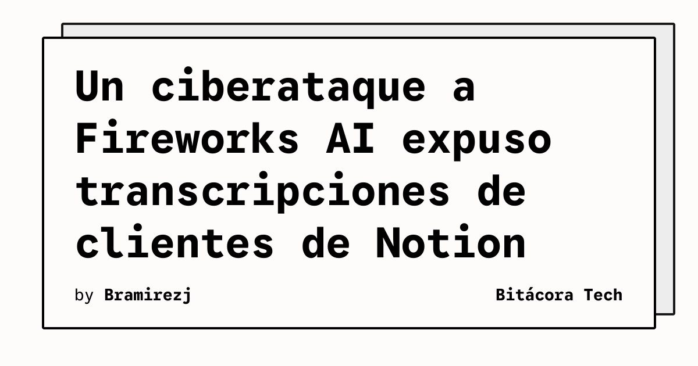

El incidente atribuido a Fireworks AI vuelve a poner el foco en una superficie poco visible de los servicios de inteligencia artificial: los registros que se generan mientras los usuarios conversan con un modelo. Según el reporte de TechCrunch, un ciberataque permitió a los atacantes acceder a transcripciones de chats de clientes de Notion. El artículo señala además que se trata de la segunda brecha de datos de Fireworks en dos meses.

La información disponible confirma dos elementos concretos: el proveedor afectado es Fireworks AI y los registros comprometidos corresponden a clientes de Notion. No permite afirmar, sin embargo, el número de cuentas afectadas, el periodo de exposición ni el tipo de datos que contenían todas las conversaciones. Esas precisiones requieren la comunicación técnica de las empresas involucradas.

## Qué implica

Las transcripciones no son un subproducto trivial. Pueden contener preguntas internas, fragmentos de código, decisiones de producto o información aportada durante una sesión de trabajo. Cuando una aplicación delega el procesamiento en un proveedor externo, la seguridad de esa cadena también pasa a formar parte del riesgo operativo de la aplicación principal.

El caso también ilustra la diferencia entre proteger el modelo y proteger el entorno que lo sirve. Aunque el modelo responda correctamente, una intrusión en la cuenta, el almacenamiento o los sistemas de soporte puede exponer el historial asociado a las solicitudes. Para los equipos técnicos, la revisión debe abarcar permisos, retención, segmentación y trazabilidad, no solo la calidad de la respuesta generada.

## Hechos confirmados

- TechCrunch reporta un ciberataque contra Fireworks AI.
- El acceso incluyó transcripciones de chats de clientes de Notion.
- El medio describe el episodio como la segunda brecha de Fireworks en dos meses.

## Análisis

La recurrencia temporal es el dato más relevante para la gestión de proveedores. No demuestra por sí sola que exista una misma causa técnica, pero sí justifica pedir un informe de alcance, medidas correctivas y controles de acceso verificables antes de ampliar el uso del servicio. En flujos con información sensible, minimizar la retención y separar los datos de identificación del contenido conversacional puede reducir el impacto de un incidente similar.

**Fuente:** [TechCrunch](https://techcrunch.com/2026/11/12/cyberattack-on-fireworks-ai-allowed-hackers-to-access-notion-customers-chat-transcripts/).
