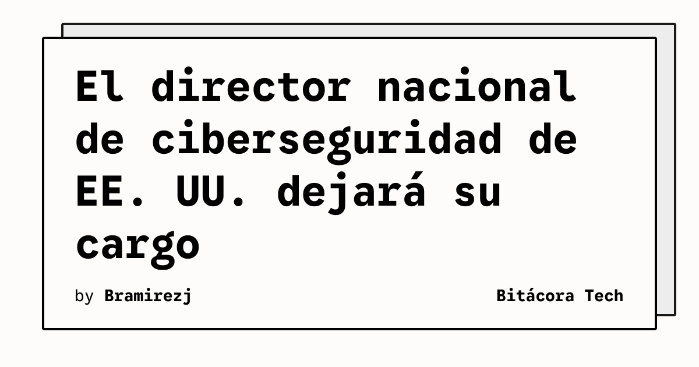

Sean Cairncross dejará su puesto como director nacional de ciberseguridad de Estados Unidos, informó Axios y recogió TechCrunch. El relevo se produce mientras empresas del país reportan varias interrupciones técnicas cuya causa todavía no está clara. La salida añade un cambio de liderazgo a un momento de atención pública sobre la resiliencia digital.

## Qué implica

La oficina asesora al presidente en política y estrategia nacionales de ciberseguridad. Un cambio en su dirección puede afectar prioridades, coordinación interinstitucional y la relación con empresas tecnológicas, aunque el artículo no anticipa qué orientación tendrá el reemplazo.

TechCrunch señala que el momento también está condicionado por el próximo control demócrata del Congreso. Según el reporte citado por el medio, la salida fue amistosa y se programó para que la Casa Blanca pudiera obtener confirmación del Senado antes de enero. La sucesión, por tanto, combina una decisión administrativa con una ventana política concreta. También obliga a separar los hechos confirmados de las especulaciones sobre sus motivos: TechCrunch describe una salida amistosa y no afirma que las interrupciones técnicas hayan provocado el cambio.

## Hechos confirmados

- Axios reportó que Sean Cairncross dejará la dirección nacional de ciberseguridad.
- Cairncross asumió el cargo en agosto de 2025.
- El Senado confirmó su nombramiento por 59 votos contra 35.
- Desde el puesto, se reunió con líderes de IA y participó en decisiones de la administración sobre inteligencia artificial.
- TechCrunch indicó que la Casa Blanca fue contactada para hacer comentarios.

## Análisis

La continuidad operativa será más importante que el nombre del reemplazo. En un entorno donde convergen IA, infraestructura heredada y servicios críticos, la oficina necesita mantener canales estables con operadores públicos y privados. La transición también será una prueba de si la política de ciberseguridad puede sostenerse como capacidad institucional y no depender demasiado de una sola figura.

**Fuente:** [TechCrunch](https://techcrunch.com/2026/11/20/the-u-s-national-cyber-director-is-stepping-down/).
