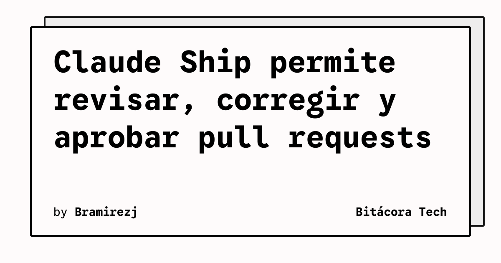

Anthropic presentó Claude Ship, un conjunto de funciones orientado a equipos de ingeniería. La compañía afirma que Claude puede revisar pull requests, corregir cambios y aprobar modificaciones cuando las políticas de la organización lo permiten.

## Qué implica

La novedad desplaza a los agentes de IA desde la generación de código hacia una parte más operativa del ciclo de entrega. En lugar de limitarse a proponer una modificación, el sistema puede intervenir después: analizar comentarios, atender fallos de integración continua y participar en el proceso de aprobación.

El paquete incorpora PR Steward y Claude Approvals, ambos en beta. PR Steward puede actuar ante comprobaciones de CI fallidas, conflictos de fusión y comentarios de revisión procedentes de Code Review, otras herramientas o miembros del equipo. Claude Approvals evalúa señales definidas por la organización y puede aprobar cambios rutinarios si la política correspondiente lo autoriza.

## Hechos confirmados

- Claude Ship incluye capacidades para revisar, corregir y aprobar pull requests.
- PR Steward atiende fallos de CI, conflictos de fusión y comentarios de revisión, y deja comentarios sobre sus cambios.
- Claude Approvals puede aprobar modificaciones rutinarias cuando las políticas del equipo lo permiten.
- Las organizaciones pueden proporcionar señales adicionales, incluidos resultados de Code Review o clasificadores propios expresados en lenguaje natural.
- PR Steward y Claude Approvals se lanzan en beta.
- Claude Ship está disponible para clientes de Claude Team y Enterprise y funciona con repositorios alojados en GitHub.

## Análisis

Automatizar tareas de mantenimiento puede reducir el tiempo que los equipos dedican a problemas repetitivos, pero también eleva la importancia de las reglas de autorización. Una aprobación automática solo es razonable si el alcance del cambio, los controles de CI y las rutas de escalado están claros. La integración es, por tanto, menos una sustitución de la revisión humana que una nueva capa de automatización que cada organización deberá limitar y auditar.

La posibilidad de actuar sobre conflictos y feedback también puede cambiar el flujo de trabajo: el agente no solo produce código, sino que responde a señales del repositorio. La calidad real dependerá de cómo documente sus decisiones y de cuándo sepa detenerse.

**Fuente:** [The Verge](https://www.theverge.com/ai-artificial-intelligence/1040134/anthropic-claude-ship-ai-pull-requests).
