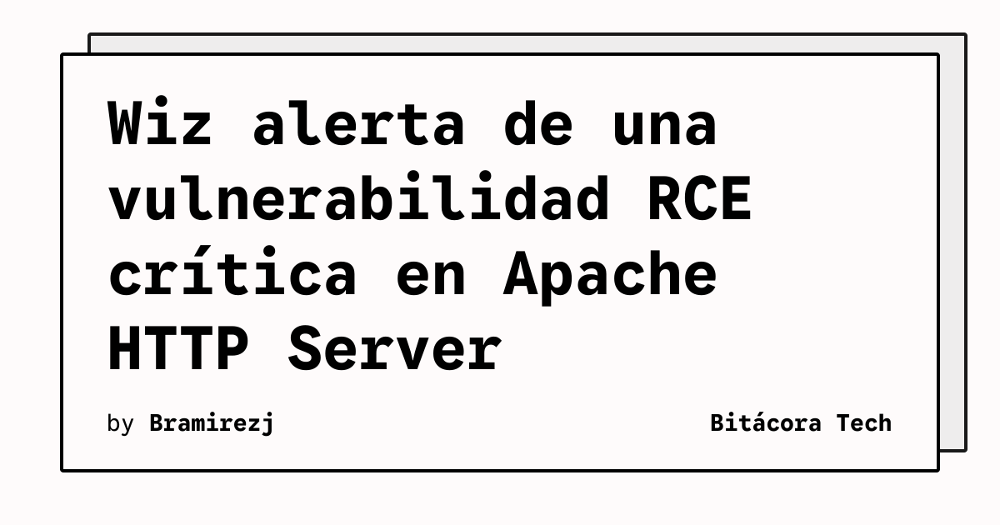

Wiz publicó un análisis de CVE-2026-119618, una vulnerabilidad crítica de ejecución remota de código en el módulo HTTP/2 (`mod_http2`) de Apache HTTP Server. El problema se debe a una condición de carrera durante la ejecución concurrente de `assign_headers()` al gestionar recursos compartidos.

## Qué implica

Según el análisis de Wiz, un atacante remoto no autenticado podría corromper memoria del heap y llegar a ejecutar código arbitrario si consigue explotar la vulnerabilidad. La empresa indica que, al publicar su aviso, no existía un exploit conocido ni había informes de explotación activa.

Wiz afirma además que sus datos muestran recursos vulnerables en el 64 % de los entornos cloud analizados. Esa cifra corresponde a la medición de Wiz y no describe automáticamente la exposición de cada organización, por lo que los equipos deben revisar sus propios inventarios y configuraciones.

## Hechos confirmados

- CVE-2026-119618 afecta al módulo HTTP/2 de Apache HTTP Server.
- El fallo está relacionado con una condición de carrera en `assign_headers()`.
- Wiz recomienda actualizar Apache HTTP Server a la versión 2.4.71 o posterior.
- Para instalaciones que no puedan parchearse de inmediato, Wiz propone desactivar temporalmente HTTP/2 y limitar los protocolos a HTTP/1.1.
- El aviso también recomienda actualizar los módulos `mod_h2` independientes a una versión posterior a 2.0.42.

## Análisis

La prioridad operativa es identificar qué servidores ejecutan el módulo afectado y confirmar la versión instalada antes de aplicar una mitigación. También conviene revisar servicios publicados detrás de proxies o balanceadores, porque la exposición depende de cómo se negocia y termina HTTP/2 en cada arquitectura. Desactivar HTTP/2 puede reducir temporalmente la superficie de ataque, pero también puede alterar el rendimiento y la compatibilidad de las aplicaciones. La actualización debe probarse y desplegarse con el procedimiento habitual de cambios urgentes, junto con una revisión de registros y de los controles que protegen los servicios expuestos.

**Fuente:** [Wiz](https://www.wiz.io/blog/cve-2026-119618-rce-apache-http-server-vulnerability).
