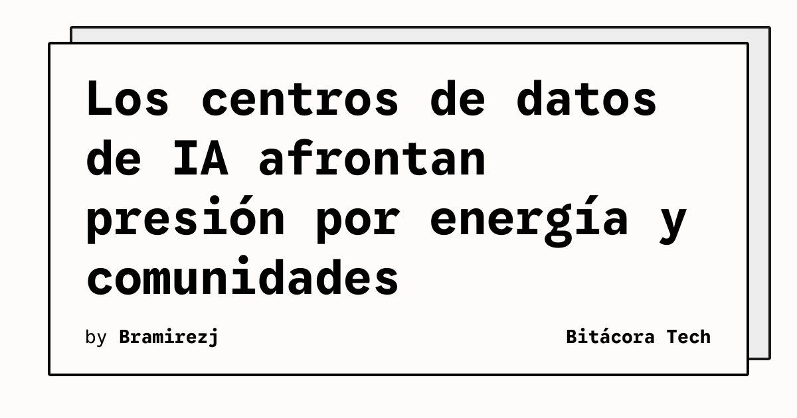

La expansión de centros de datos para sostener servicios de inteligencia artificial está trasladando parte del debate tecnológico hacia la energía, los permisos y la relación con las comunidades locales. The Verge reúne en una cobertura especial los principales desarrollos y controversias alrededor de estas instalaciones.

## Qué implica

El artículo explica que los centros de datos se han convertido en una pieza física central para las ambiciones de las grandes compañías de IA, pero que su crecimiento también aumenta la presión sobre las redes eléctricas y los territorios donde se construyen. El impacto no se limita a la disponibilidad de servidores: también afecta a la planificación energética, las facturas de los servicios públicos y la evaluación ambiental.

La cobertura señala que los centros de datos fueron un asunto político relevante antes de las elecciones intermedias estadounidenses de 2026 y que los votantes se opusieron ampliamente a su expansión. Tras esos comicios, dirigentes demócratas han planteado nuevas restricciones y pausas que las empresas de IA deberán considerar.

## Hechos confirmados

- OpenAI y Amazon han prometido trabajar más estrechamente con las comunidades locales y asumir los costes energéticos de sus centros de datos.
- Un proyecto legislativo con apoyo bipartidista busca acelerar la autorización de proyectos energéticos y podría reducir los costes de electricidad, aunque también limitaría la supervisión ambiental.
- Organizaciones ambientales advierten que una tramitación más rápida podría favorecer proyectos contaminantes y reducir la capacidad de las comunidades para impugnarlos.
- OpenAI anunció que no utilizará acuerdos de confidencialidad con funcionarios públicos en sus proyectos, salvo protecciones limitadas para información de seguridad, secretos comerciales o datos competitivos.

## Análisis

La noticia muestra que escalar IA exige resolver un problema de infraestructura que no se arregla únicamente comprando más aceleradores. La transparencia sobre consumo, permisos y costes puede convertirse en una condición práctica para obtener apoyo local. Para los equipos técnicos, esto sugiere que la capacidad de cómputo deberá evaluarse junto con disponibilidad eléctrica, ubicación y restricciones regulatorias, no como una capa separada.

**Fuente:** [The Verge](https://www.theverge.com/ai-artificial-intelligence/902546/data-centers-ai-energy-power-grids-controversy).
