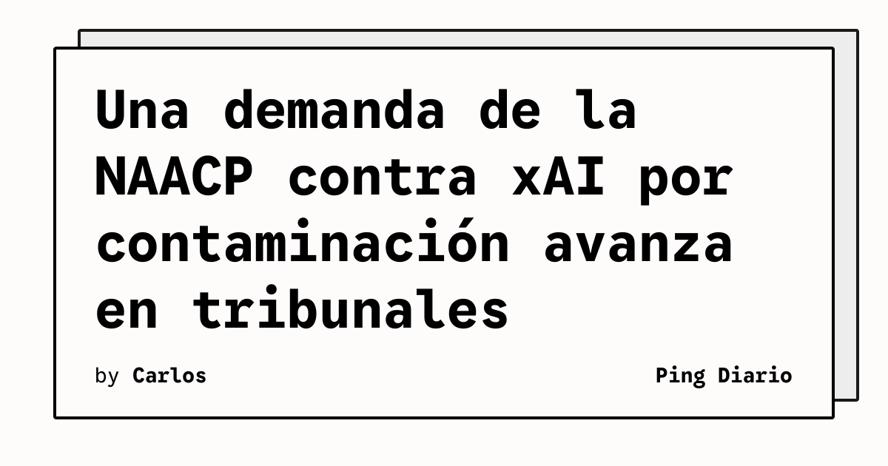

Una demanda presentada por la NAACP contra xAI, la compañía de inteligencia artificial propiedad de SpaceX, podrá continuar su tramitación. TechCrunch informa que la organización acusa a la empresa de infringir la Clean Air Act por la contaminación asociada con su centro de datos.

## Qué implica

El caso sitúa la operación física de la infraestructura de IA dentro de una disputa legal y ambiental. La resolución no equivale a una sentencia sobre el fondo de las acusaciones: permite que el procedimiento siga adelante y que las partes presenten sus argumentos ante el tribunal.

Para quienes construyen o consumen servicios de IA, el episodio muestra que la evaluación de un sistema no termina en el modelo ni en la API. La electricidad, los equipos y las emisiones vinculadas a los centros de datos también pueden convertirse en asuntos de cumplimiento y escrutinio público.

## Hechos confirmados

- La NAACP presentó una demanda contra xAI relacionada con la contaminación de un centro de datos.
- La acusación sostiene que xAI infringió la Clean Air Act.
- Un juez permitió que la demanda avance.

## Análisis

La decisión puede aumentar la atención sobre los requisitos ambientales aplicables a la expansión de infraestructura para inteligencia artificial. Sin embargo, todavía no permite concluir que xAI haya violado la ley: esa cuestión deberá resolverse durante el proceso. Para los operadores, documentar permisos, emisiones y medidas de mitigación será cada vez más importante cuando amplíen capacidad.

**Fuente:** [TechCrunch](https://techcrunch.com/2026/10/31/judge-allows-naacp-lawsuit-over-xai-data-center-pollution-to-move-forward/).
