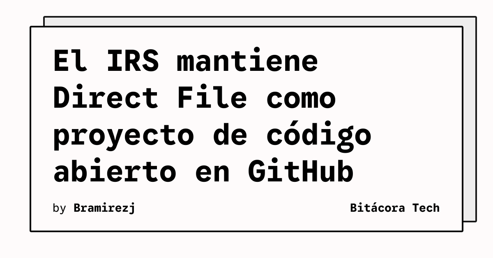

Direct File, el servicio de declaración de impuestos en línea del Internal Revenue Service de Estados Unidos, aparece en el feed como una de las historias de código abierto más relevantes de la jornada. La fuente primaria es el repositorio público `IRS-Public/direct-file` en GitHub, que identifica el proyecto con el nombre Direct File y permite consultar su desarrollo.

## Qué implica

La publicación del repositorio hace visible una pieza de infraestructura digital empleada en un servicio público. Para equipos técnicos, el interés no está solo en el formulario final: un repositorio abierto permite revisar decisiones de implementación, seguir cambios y estudiar cómo se organiza un producto que debe atender a contribuyentes y reglas fiscales.

También ofrece un punto de referencia para comparar prácticas de ingeniería pública con las de productos comerciales. La actividad del proyecto, sus incidencias y la documentación pueden mostrar cómo se priorizan cambios cuando el software tiene una obligación operativa y legal. Esas señales son más útiles que interpretar la mera existencia del repositorio como una garantía de calidad.

La entrada del feed enlaza directamente a GitHub, no a una nota de un agregador. La página confirma que se trata del repositorio de Direct File y ofrece la posibilidad de contribuir mediante una cuenta. El material consultado no permite afirmar por sí solo qué estados, tipos de declaración o funcionalidades están disponibles en una versión concreta, por lo que esos detalles quedan fuera de esta nota.

## Hechos confirmados

- El repositorio público se encuentra bajo la organización `IRS-Public` en GitHub.
- El proyecto se denomina Direct File.
- GitHub presenta el repositorio como un espacio abierto para consultar su desarrollo y contribuir.
- La historia del feed está clasificada como Open Source y fue publicada el 14 de noviembre de 2026.

## Análisis

Un proyecto público de este tipo puede mejorar la trazabilidad de un servicio gubernamental y facilitar auditorías técnicas independientes. También expone una tensión habitual: abrir el código no garantiza que toda la arquitectura, operación o toma de decisiones sea igualmente transparente. Para evaluar el proyecto con rigor habría que revisar la documentación, el historial de cambios, las pruebas y las políticas de contribución, además de comprobar qué parte del servicio se ejecuta realmente con este código.

**Fuente:** [repositorio Direct File del IRS en GitHub](https://github.com/IRS-Public/direct-file).
