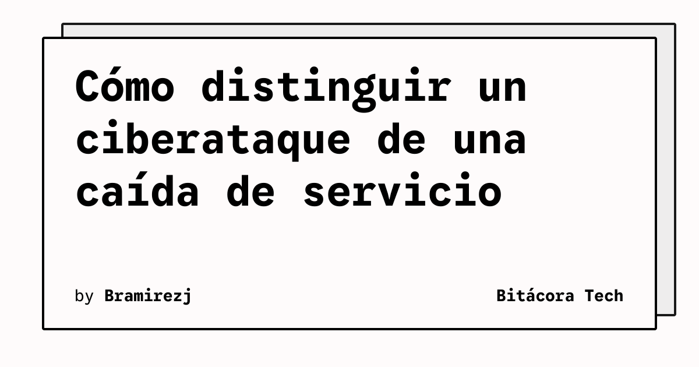

Cuando un servicio deja de responder, la primera reacción suele buscar una causa maliciosa. Ars Technica plantea una advertencia necesaria: una caída no demuestra por sí sola que exista un ciberataque. El diagnóstico debe separar los síntomas observables de las hipótesis sobre su origen.

## Qué implica

La diferencia importa porque las primeras decisiones pueden ampliar o reducir el impacto. Si un equipo trata una incidencia operativa como una intrusión sin evidencia, puede desviar recursos, alterar sistemas y retrasar la recuperación. Si descarta demasiado pronto la posibilidad de un ataque, puede perder tiempo valioso de contención.

La respuesta requiere correlacionar disponibilidad, cambios recientes, registros de autenticación, tráfico anómalo y comunicaciones del proveedor. También conviene mantener un registro temporal de los hechos: qué dejó de funcionar, cuándo empezó, qué componentes comparten dependencia y qué acciones modificaron el estado.

En la práctica, la comunicación interna debe reflejar esa incertidumbre. Es preferible decir que existe una interrupción bajo investigación que atribuirla a un atacante sin pruebas. Esa precisión permite que el equipo de operaciones siga restaurando el servicio mientras seguridad conserva evidencias y busca indicadores de compromiso.

El mismo criterio se aplica a los avisos externos. Un proveedor puede confirmar una incidencia de disponibilidad antes de conocer su causa raíz, y esa confirmación no debe transformarse automáticamente en una declaración sobre seguridad. Las líneas de tiempo separadas para impacto, mitigación y causa ayudan a evitar conclusiones contradictorias.

## Hechos confirmados

- Ars Technica publicó una guía titulada «How to tell a cyberattack from a plain old outage».
- El resumen de la fuente advierte que no se debe asumir que cada interrupción es un ciberataque.
- La historia fue clasificada en el feed como una noticia de alta prioridad dentro de tecnología.
- La fuente accesible separa el hecho de una interrupción del diagnóstico de su causa.

## Análisis

La observabilidad debe servir también para descartar explicaciones, no solo para producir alertas. Un buen procedimiento de respuesta conserva evidencias antes de aplicar cambios, asigna responsables para operaciones y seguridad, y comunica el nivel de confianza de cada hipótesis. Esa disciplina evita titulares prematuros y permite escalar a una investigación forense cuando aparecen indicadores concretos de compromiso.

**Fuente:** [Ars Technica](https://arstechnica.com/security/2026/11/how-to-tell-a-cyberattack-from-a-plain-old-outage/).
