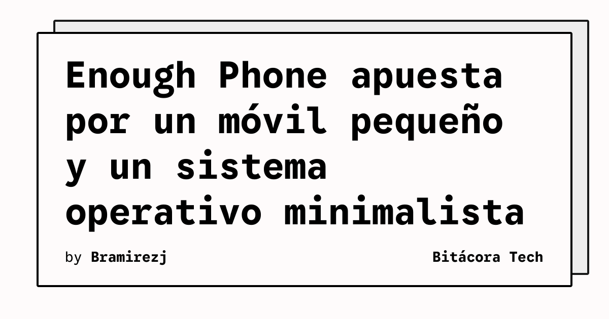

Enough Phone es el intento de una startup por recuperar los teléfonos compactos, en un mercado dominado por pantallas grandes. Brennan Jordan y Austin Boer, dos de los tres responsables del proyecto, buscan financiación en Kickstarter para fabricar el dispositivo.

La campaña superó la mitad de su objetivo de 250.000 dólares un día después de su lanzamiento, según The Verge. El teléfono pretende combinar unas dimensiones cercanas a las del antiguo iPhone Mini con la posibilidad de elegir entre Android estándar y OdysseyOS, un sistema operativo minimalista desarrollado por el equipo.

## Qué implica

El proyecto no se limita a reducir el tamaño del panel. La propuesta incluye una batería de 3.500 mAh que el usuario podrá reemplazar, una pantalla de 5,3 pulgadas, un chip MediaTek Dimensity 7500, 8 GB de RAM y un sensor Sony de 50 megapíxeles para la cámara trasera.

La batería reemplazable puede facilitar reparaciones y prolongar el uso del equipo, aunque el resultado dependerá del diseño final y de la disponibilidad de repuestos. La opción de OdysseyOS también sitúa el proyecto en el debate sobre teléfonos que reducen las distracciones sin renunciar por completo a las aplicaciones de Android.

Jordan y Boer ya habían cofundado Sleke, una empresa que vende teléfonos reacondicionados con OdysseyOS. El nuevo hardware responde, según explicaron, a clientes que querían ese sistema en un teléfono más pequeño. El equipo ofrecía lotes de teléfonos Pixel 8 y Pixel 9, pero esos modelos no resolvían la preferencia por un formato compacto.

## Hechos confirmados

- Enough Phone busca financiación en Kickstarter con un objetivo de 250.000 dólares.
- El dispositivo apunta a una pantalla de 5,3 pulgadas y una batería reemplazable de 3.500 mAh.
- Sus especificaciones objetivo incluyen MediaTek Dimensity 7500, 8 GB de RAM y una cámara Sony de 50 megapíxeles.
- El teléfono podrá usar Android estándar u OdysseyOS, según la propuesta publicada.
- El proyecto está relacionado con Sleke, que vende teléfonos reacondicionados con OdysseyOS.

## Análisis

Enough Phone compite menos por cifras máximas que por control sobre el tamaño, la batería y el software. Esa combinación puede atraer a usuarios que consideran excesivas las dimensiones actuales, pero una campaña exitosa todavía no garantiza producción, soporte prolongado ni compatibilidad completa. Antes de adoptarlo, convendrá comprobar el calendario de entrega, la garantía y la disponibilidad de piezas.

**Fuente:** [The Verge](https://www.theverge.com/tech/1028160/enough-small-phone-kickstarter-sleke).
