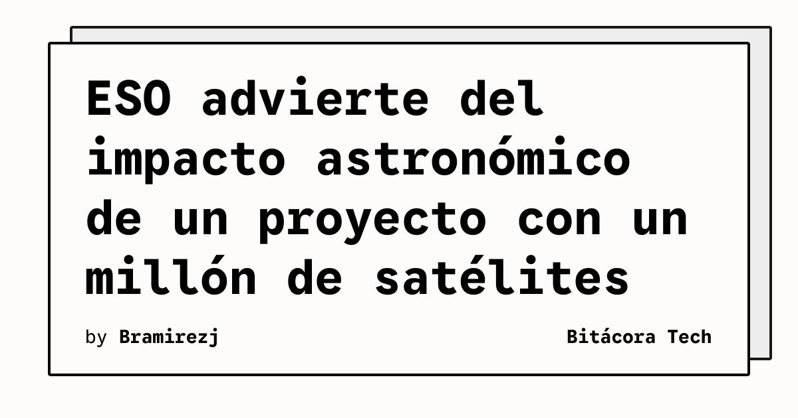

El Observatorio Europeo Austral (ESO) publicó una declaración sobre la aprobación del lanzamiento de un proyecto que contempla hasta un millón de satélites para centros de datos espaciales. La organización afirma que la decisión puede tener consecuencias globales para la astronomía y para la sostenibilidad del entorno espacial.

Según la declaración del ESO, la Comisión Federal de Comunicaciones de Estados Unidos anunció el 25 de noviembre la aprobación relacionada con esos proyectos. El organismo astronómico advierte que, aunque compañías de satélites como SpaceX trabajan para reducir el brillo individual de sus unidades, el volumen total previsto puede producir más trazas en las imágenes de los observatorios de las que sea posible mitigar.

## Qué implica

El problema no se limita a una fotografía afectada. Las trazas de satélite pueden interferir con observaciones ópticas y aumentar el trabajo necesario para distinguir señales astronómicas de objetos en órbita. El ESO también señala un posible impacto en la radioastronomía: una constelación de esta escala generaría ruido de radio que debe considerarse junto con la contaminación luminosa.

La declaración no presenta una medición nueva del daño sobre cada observatorio ni describe una mitigación ya ejecutada para este proyecto concreto. Su petición es de gobernanza: el ESO sostiene que las decisiones con consecuencias internacionales deben apoyarse en evidencia científica y evaluarse mediante marcos internacionales adecuados.

## Hechos confirmados

- El ESO publicó la declaración el 27 de noviembre de 2026.
- El texto se refiere a proyectos que podrían desplegar hasta un millón de satélites.
- La organización relaciona el despliegue con trazas en imágenes astronómicas y ruido de radio.
- El ESO reconoce que algunas compañías trabajan para reducir el brillo de satélites individuales.
- La declaración pide equilibrar innovación, protección del cielo nocturno, investigación y sostenibilidad espacial.

## Análisis

El caso muestra una tensión técnica entre ampliar infraestructura orbital y preservar el entorno de observación del que depende la astronomía. Si el número de satélites crece hasta la escala descrita, la mitigación por unidad podría no bastar: el efecto acumulado pasa a ser una variable de diseño y regulación desde el inicio del proyecto.

**Fuente:** [European Southern Observatory](https://www.eso.org/public/news/eso2614/).
