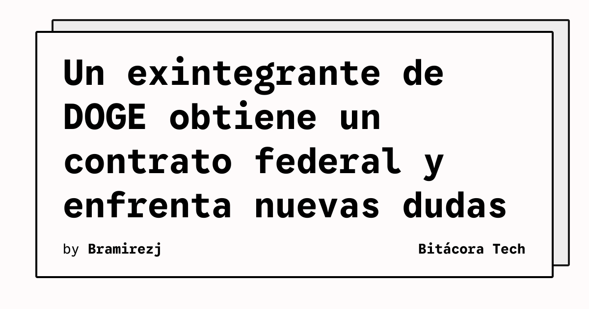

El caso de Yat Choi conecta la administración pública estadounidense, la contratación tecnológica y una nueva empresa privada. Según Wired, Choi, ciudadano canadiense, pasó de trabajar con DOGE al National Design Studio antes de crear Govmaxxing. La publicación también informa que su compañía obtuvo un contrato federal, en un proceso que después se volvió controvertido.

La historia importa para los equipos que venden software o servicios al sector público porque muestra que la experiencia reciente dentro del Gobierno puede convertirse rápidamente en una ventaja comercial. También plantea la necesidad de separar los hechos comprobables sobre un contrato de las interpretaciones acerca de sus posibles conflictos o de la calidad de la prestación.

## Qué implica

Para una empresa tecnológica, entrar en la contratación federal no depende únicamente del producto. El historial profesional de sus fundadores, los requisitos de elegibilidad, la documentación de la oferta y la supervisión posterior forman parte del riesgo operativo. Un equipo que haya trabajado dentro de una agencia puede conocer mejor sus procesos, pero esa cercanía exige controles claros sobre acceso a información, conflictos de interés y trato equitativo entre oferentes.

La situación también es relevante para quienes diseñan herramientas de compras públicas. Los registros de adjudicación, las declaraciones de intereses y las trazas de evaluación deberían poder revisarse sin depender de explicaciones informales. La transparencia técnica no resuelve por sí sola una controversia, pero permite reconstruir qué se decidió, cuándo y con qué criterios.

## Hechos confirmados

- Wired identifica a Yat Choi como ciudadano canadiense y señala que pasó de DOGE al National Design Studio.
- La publicación indica que Choi creó Govmaxxing después de ese recorrido.
- El artículo informa que la empresa obtuvo un contrato federal y que el proceso derivó en dificultades posteriores.

## Análisis

El episodio sugiere que la movilidad entre el Gobierno y los proveedores tecnológicos necesita reglas visibles y verificables. No basta con revisar el resultado de una adjudicación: también conviene auditar la separación entre funciones públicas y oportunidades privadas. Esa lectura es especialmente importante en áreas donde las decisiones se apoyan en sistemas digitales y el conocimiento interno puede ser difícil de evaluar desde fuera.

**Fuente:** [Wired](https://www.wired.com/story/he-worked-with-doge-now-hes-bidding-for-government-contracts/).
