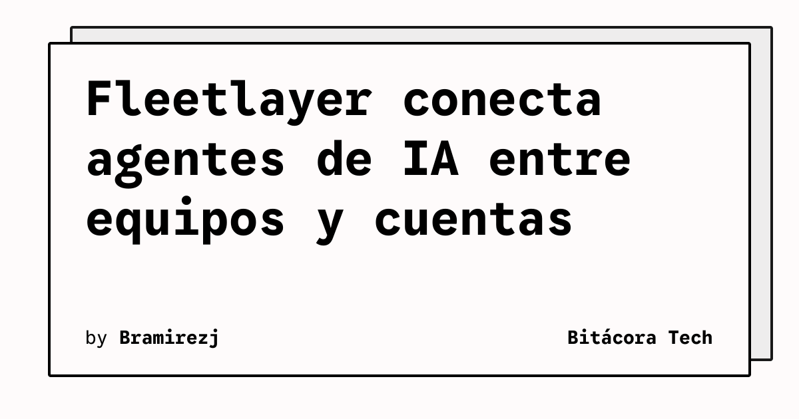

Fleetlayer presenta una capa de coordinación para ejecutar agentes de IA en más de una máquina o cuenta. El proyecto conecta sesiones de Claude Code y Codex en portátiles, servidores domésticos y VPS, con la promesa de mantener los equipos y los accesos bajo control del usuario.

La propuesta parte de un problema práctico: una sesión que corre en un servidor no puede comunicarse de forma nativa con otra que trabaja en un portátil, y un agente remoto tampoco puede usar directamente el navegador autenticado del equipo local. Fleetlayer reúne esas sesiones en un panel y añade mensajería entre agentes.

## Qué implica

El proyecto organiza cada equipo o usuario Unix mediante un nodo que mantiene una conexión saliente con el plano de control. Según la documentación publicada, ese diseño permite trabajar detrás de NAT sin abrir puertos de entrada. Las sesiones pueden identificarse por máquina y cuenta, y los comandos de mensajería se ejecutan desde la terminal.

También se contempla compartir herramientas que existen en una máquina concreta. La página del proyecto describe un caso en el que un agente del servidor puede solicitar el navegador autenticado del portátil mediante Playwright MCP, siempre que la política permita ese acceso. El mismo modelo se aplica a archivos y a páginas generadas por agentes.

La separación por usuarios y nodos busca evitar que todas las sesiones tengan los mismos permisos. Fleetlayer describe reglas para decidir qué agente puede enviar mensajes, iniciar o tomar control de otra sesión y solicitar acciones sensibles. Las solicitudes que requieren aprobación pueden quedar pendientes del usuario.

## Hechos confirmados

- Fleetlayer conecta sesiones de Claude Code y Codex que se ejecutan en distintos equipos y bajo distintas cuentas.
- El sitio ofrece mensajería entre agentes, un registro de eventos y un panel para consultar máquinas y sesiones.
- La arquitectura descrita usa nodos por máquina o usuario Unix y una conexión saliente al plano de control.
- El proyecto se presenta como autoalojable y con código disponible públicamente; su sitio enlaza el repositorio en GitHub.

## Análisis

La utilidad de Fleetlayer depende menos de lanzar otro agente que de coordinar el contexto, las credenciales y las herramientas que ya existen en varios equipos. Esa combinación puede reducir el trabajo manual cuando un flujo necesita pasar de una sesión de desarrollo a otra de infraestructura.

El punto delicado será la política de acceso. Conectar navegadores autenticados, archivos y cuentas de IA amplía la superficie de impacto de un agente mal configurado. Por eso, el registro de acciones y las aprobaciones no son detalles accesorios: deberían formar parte de la evaluación antes de usarlo con datos sensibles.

**Fuente:** [Fleetlayer](https://fleetlayer.ai/), verificada y abierta.
